# Regions & Level Flow

## Prototype spine (playable Godot order)

Compressed for the current `oz/` build — full design table below still holds for the long game.

| Play level | Scene | Role |
| --- | --- | --- |
| **L1** | Kansas farmyard | B&W prologue · enterable farm · storm house-lift → Munchkinland · grey **Whimsy** side score |
| **L2** | Munchkinland landing | **Linear YBR N→S:** Locasta (before house) → Shoes → SC → Lion → Tin → **YBR south FINAL STEP** → West |
| **L3** | Winkie · West castle | Court → West (F/axe) → **cistern water melt** → **open YBR arch north** (no solid gatehouse) → Emerald |
| **L4** | Emerald City · Wizard's tower | **YBR** approach · enterable hall · projection · curtain → **YBR south to Glinda** |
| **L5** | Quadling · Glinda's court | Glinda South · shoes truth · **Road Home pad FINAL STEP** (prototype ending) |

**Playtest skips:** F9 Kansas→L2 · F10 L2→West · F11 L2→Emerald · F9 West→Emerald · F9 Emerald→Glinda · F8/F9 on L5 counsel/ending.

**Rule:** the **Yellow Brick Road** is always the continuous path to the next destination / level exit. Never seal a level exit with a solid block building across the brick.

**L2 lost?** Stay on the **Yellow Brick Road** (N→S corridor). Order on the brick: Locasta (before house) → Shoes under house → Scarecrow → Lion → Tin Man → south glowing West gate. Optional **Whimsy** is off the brick (not story-gated).

**L3 stuck on West?** She does **not** die to F spam. Weaken until **GROUNDED — WATER!**, compass → **Cistern**, **E** draw, **E** douse. After melt: follow YBR **north** through the **open arch** to the green Emerald pad (E).

**L3→L4 blocked?** There is no solid gatehouse fill — pillars + lintel only; brick continues through the wall gap to `EmeraldGatePad`.

**L4→L5:** after curtain choice, hourglass → Glinda court; stay on YBR south to pink Road Home pad.

**Whimsy (every level):** optional side score — bounce / giggle / chime / dance; shared `Whimsy` autoload; regional palette; never story-gated.

### Book vs game order (important)

Baum *Wonderful Wizard of Oz* road order:

1. Munchkinland / party on the **Yellow Brick Road**
2. **Emerald City first audience** (Wizard commissions killing the West)
3. **Winkie / West castle** (defeat)
4. **Return** to Emerald City (humbug revealed)
5. Glinda / Road Home

**This vault's act table** and the **prototype spine** place **West (L3) before Emerald finale (L4)** so the Wizard curtain is the Act 4 climax after the regime falls. Prototype dialogue acknowledges West is already gone when Oz blusters. A later pass may insert a short **first Emerald commission** beat on the YBR between L2 and L3 if we want stricter Baum pacing without two full Emerald levels.

**Name:** not "Tower of Oz" — **Emerald City** / the **Wizard's palace-tower**.

## Region Table

| # | Region | Act | Companion | Boss | Enemy families | Traversal gate |
| --- | --- | --- | --- | --- | --- | --- |
| -1 | Kansas / House Interior / Flight | 0 (prologue) | — | [[Witch of the East]] (landing) | Storm debris, house objects | None — tutorial |
| 0 | Munchkinland (landing) | 1 | — | [[Witch of the East]] (set piece) | Rogue Munchkins | None — tutorial |
| 1 | Munchkinland Fields / Lollipop Road | 1 | [[Scarecrow]] | Rogue Munchkin Marshal *(proposed)* | Rogue Munchkins, Living Trees | Kick / blink |
| 2 | The Wilds (Lions, Tigers & Bears) | 2 | [[Cowardly Lion]] | [[Mombi]] | Mangled Lions, Tigers, Bears, Living Trees | Crow control, long blink |
| 3 | Winkie Country | 3 | [[Tin Man]] | [[Witch of the West]] | Flying Monkeys, Winkie Guard *(proposed)*, Living Trees | Axe (cut), oil (traverse) |
| 4 | Emerald City / Road to Glinda | 4 | All three | [[The Wizard (Boss)]] | Guard, Flying Monkeys, constructs | Full kit |

## Flow

```mermaid
flowchart LR
  K[Kansas: B&W cutscene] --> H[House interior: canvas, close window]
  H --> F[Flight: steer the house]
  F --> A[Impact: land on the East Witch]
  A --> B[Witch of the East set piece]
  B --> C[Take the Shoes]
  C --> D[Lollipop Guild: rogue munchkins]
  D --> E[Meet Locasta / find Scarecrow]
  E --> F2[Scarecrow Boss]
  F2 --> G[Gillikin Road: Ozma is Tip]
  G --> H2[The Wilds: recruit Lion]
  H2 --> I[Mombi Boss -> free Ozma]
  I --> J[Winkie Country: Tin Man]
  J --> K2[Witch of the West Boss]
  K2 --> L[Emerald City: the Wizard]
  L --> M[Glinda / Road Home]
```

## Act Pacing

- **Act 0 (10–15 min):** black-and-white Kansas, house interior, flight, landing. Teaches movement, interact, steering, and aim.
- **Act 1 (60–90 min):** teach shoes and kick; land the tone; earn Scarecrow.
- **Act 2 (2–3 h):** open the map; stealth + roar; the Ozma reveal; Mombi.
- **Act 3 (2–3 h):** Tin Man; aerial combat; the West witch; the cost of the regime.
- **Act 4 (1–2 h):** Emerald City; Wizard; Glinda; the choice.

## Level Design Principles

1. **Readable at a glance.** Three clear lanes per arena; silhouettes over detail.
2. **Verticality for the shoes.** Ledges, gaps, and towers that reward blink/teleport routing.
3. **One new idea per room.** Teach it, test it, combine it, move on.
4. **Companion-shaped problems.** Every region has obstacles only the new companion solves.
5. **Diegetic guidance.** Toto paths and environmental breadcrumbs over waypoint spam.
6. **Arenas have exits.** Fights are readable, escapable, and re-enterable.

## Region Palettes

| Region | Palette | Mood |
| --- | --- | --- |
| Kansas (prologue) | Black, white, grey | Austere, doomed, warm |
| Munchkinland | Candy pastels, bruised purple | Charming, then wrong |
| The Wilds | Overripe greens, amber, bone | Feral, watchful |
| Winkie Country | Rust, ember, iron grey | Industrial dread |
| Emerald City | Green glass, gold, white marble | Spectacle, emptiness |
| Quadling Road | Rose, dusk blue, silver | Melancholy hope |

## Related

- [[Land of Oz]]
- [[Main Questline]]
- [[Boss Framework]]
- [[Art & Audio Direction]]
