# Regions & Level Flow

## Region Table

| # | Region | Act | Companion | Boss | Enemy families | Traversal gate |
| --- | --- | --- | --- | --- | --- | --- |
| -1 | Kansas / House Interior / Flight | 0 (prologue) | — | [[Witch of the East]] (landing) | Storm debris, house objects | None — tutorial |
| 0 | Munchkinland (landing) | 1 | — | [[Witch of the East]] (set piece) | Rogue Munchkins | None — tutorial |
| 1 | Munchkinland Fields / Lollipop Road | 1 | [[Scarecrow]] | Rogue Munchkin Marshal *(proposed)* | Rogue Munchkins, Living Trees | Kick / blink |
| 2 | The Wilds (Lions, Tigers & Bears) | 2 | [[Cowardly Lion]] | [[Mombi]] | Mangled Lions, Tigers, Bears, Living Trees | Crow control, long blink |
| 3 | Winkie Country | 3 | [[Tin Man]] | [[Witch of the West]] | Flying Monkeys, Winkie Guard *(proposed)*, Living Trees | Axe (cut), oil (traverse) |
| 4 | Emerald City / Road to Glinda | 4 | All three | [[The Wizard (Boss)]] | Guard, Flying Monkeys, constructs | Full kit |

## Flow

```mermaid
flowchart LR
  K[Kansas: B&W cutscene] --> H[House interior: canvas, close window]
  H --> F[Flight: steer the house]
  F --> A[Impact: land on the East Witch]
  A --> B[Witch of the East set piece]
  B --> C[Take the Shoes]
  C --> D[Lollipop Guild: rogue munchkins]
  D --> E[Meet Locasta / find Scarecrow]
  E --> F2[Scarecrow Boss]
  F2 --> G[Gillikin Road: Ozma is Tip]
  G --> H2[The Wilds: recruit Lion]
  H2 --> I[Mombi Boss -> free Ozma]
  I --> J[Winkie Country: Tin Man]
  J --> K2[Witch of the West Boss]
  K2 --> L[Emerald City: the Wizard]
  L --> M[Glinda / Road Home]
```

## Act Pacing

- **Act 0 (10–15 min):** black-and-white Kansas, house interior, flight, landing. Teaches movement, interact, steering, and aim.
- **Act 1 (60–90 min):** teach shoes and kick; land the tone; earn Scarecrow.
- **Act 2 (2–3 h):** open the map; stealth + roar; the Ozma reveal; Mombi.
- **Act 3 (2–3 h):** Tin Man; aerial combat; the West witch; the cost of the regime.
- **Act 4 (1–2 h):** Emerald City; Wizard; Glinda; the choice.

## Level Design Principles

1. **Readable at a glance.** Three clear lanes per arena; silhouettes over detail.
2. **Verticality for the shoes.** Ledges, gaps, and towers that reward blink/teleport routing.
3. **One new idea per room.** Teach it, test it, combine it, move on.
4. **Companion-shaped problems.** Every region has obstacles only the new companion solves.
5. **Diegetic guidance.** Toto paths and environmental breadcrumbs over waypoint spam.
6. **Arenas have exits.** Fights are readable, escapable, and re-enterable.

## Region Palettes

| Region | Palette | Mood |
| --- | --- | --- |
| Kansas (prologue) | Black, white, grey | Austere, doomed, warm |
| Munchkinland | Candy pastels, bruised purple | Charming, then wrong |
| The Wilds | Overripe greens, amber, bone | Feral, watchful |
| Winkie Country | Rust, ember, iron grey | Industrial dread |
| Emerald City | Green glass, gold, white marble | Spectacle, emptiness |
| Quadling Road | Rose, dusk blue, silver | Melancholy hope |

## Related

- [[Land of Oz]]
- [[Main Questline]]
- [[Boss Framework]]
- [[Art & Audio Direction]]
