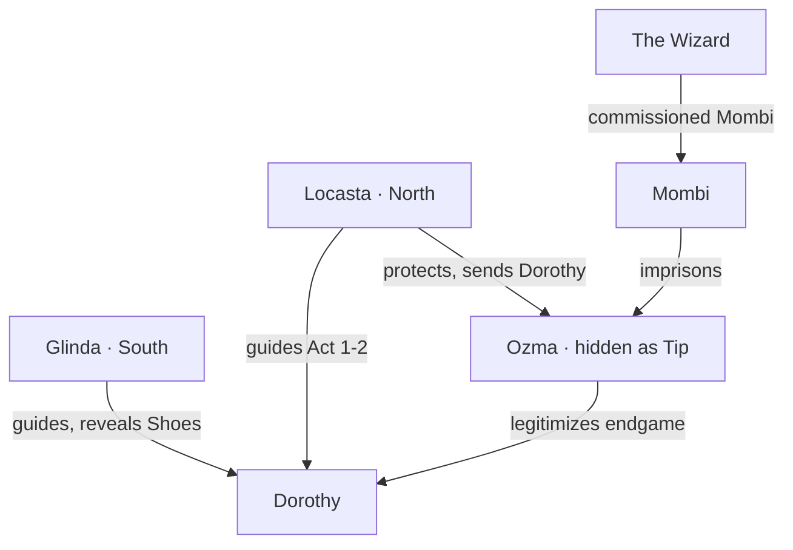

# Ozma, Locasta & Glinda

## Princess Ozma (a.k.a. “Tip”)

**Role:** The rightful ruler of Oz; the land's true key.
**State at start:** Hidden by **Mombi**, magically disguised as a young boy called **Tip**.

- Ozma is the emotional and political stakes of Act 2.
- Freeing her destabilizes the Wizard's legitimacy and turns the endgame.
- She is not a fighter — she is a **symbol that makes others brave**.
- Design: escort/protect beats in the Mombi sequence; she assists with light magic once freed.

**Reveal beat:** Dorothy has been helping “Tip” without knowing who he is. The reveal lands as a gut-punch and reframes the whole quest.

---

## Locasta — Good Witch of the North

**Role:** Act 1–2 quest-giver; protector of Ozma; keeper of the Munchkinland road.

- Practical, warm, tired of cleaning up other witches' messes.
- She cannot leave the North (domain-bound), so she sends Dorothy.
- Gives the **first real explanation of the Shoes** and the Wizard's lie.
- Her quest: clear the road, find the Scarecrow, rescue Ozma from Mombi.
- She is the one who tells Dorothy the Lion exists — and that he is afraid.

**Voice:** dry, maternal, unimpressed by destiny.

---

## Glinda — Good Witch of the South

**Role:** Act 4 guide; the one who reveals what the Shoes are *for*.

- Serene, unsettlingly well-informed, never rushes.
- She does not solve the problem; she **reframes it**.
- Reveals that the Shoes were always a key home — but the road only opens once the Wizard's machine is broken and Ozma is restored.
- Presides over the final choice ([[The Wizard (Boss)]]).

**Voice:** gentle, precise, faintly amused.

---

## Relationship Map

## Design Notes

- The three good/powerful women are **not interchangeable**: Locasta = push, Glinda = pull, Ozma = purpose.
- Keep them off the battlefield except Ozma's light support in the Mombi fight.
- All three should feel like they have lives and agendas beyond Dorothy.

## Related

- [[Mombi]]
- [[The Wizard]]
- [[Q3 - Locasta & the Princess]]
- [[Q4 - Glinda & the Road Home]]
