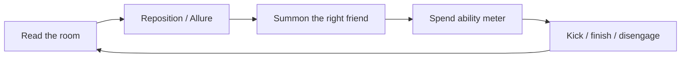
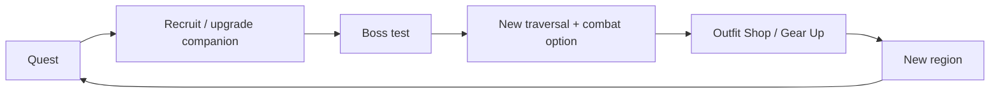

# Core Loop

## Moment-to-Moment (10–30 seconds)

1. **Read:** enemy mix, hazards, exits, verticality, and "Desire triggers."
2. **Move/Allure:** blink-dodge telegraphs, reposition, or use **Allure** (movement/attire-based distraction) to open a gap.
3. **Choose:** summon the companion whose kit answers this room.
4. **Spend:** use abilities that drain that companion's meter.
5. **Resolve:** kick to stagger/launch, disengage, or chain into the next beat.

**The skill expression is choice under pressure**, not combo execution.

## Encounter Loop (2–5 minutes)

- Enter a readable arena → 2–3 waves with a twist → reward (path opens, item, lore) → breathe.
- Every encounter should ask: *which friend is this for?*
- Failure is cheap: checkpoint at arena entry, fast retry, no resource loss.

## Region Loop (45–90 minutes)

Explore → side path (Toto hint) → quest beat → new enemy family → **companion boss** → new ability → traversal gate opens.

## Meta Loop (entire game)

The meta loop now includes the **Outfit Shop**, where Desire Fragments earned in combat are spent on kinky attire and armaments that alter Dorothy's interaction with the world.

## Session Loop

- 30–90 minute sessions should each contain: one discovery, one fight that matters, one story beat.
- Save points: before bosses, after traversal gates, at region entry.

## Resource Economy

| Resource | Owner | Regenerates | Spent on |
| --- | --- | --- | --- |
| **Spark** (shoe charges) | Dorothy | Fast, on cooldown | Blink, long teleport |
| **Allure** | Dorothy | On successful distractions | Seductive stuns, enemy manipulation |
| **Brain** | Scarecrow | Slow, on dismiss/out of combat | Crows, Confuse, Decoy, Stitch |
| **Heart** | Tin Man | Slow, on block/damage absorbed | Axe, Oil, Gilded Edge, Guard |
| **Courage** | Lion | Slow, on stealth/fear | Roar, Cloak, Pounce, Sweep |
| **Basket items** | Dorothy | Consumable | Healing, buffs, quest keys |

> [!note] Why thematic meters
> Three bars would be noise. One bar per companion makes the choice legible: *bring the friend whose meter matches the fight.*

## Failure & Retry

- Dorothy has a small health pool and strong avoidance.
- Death = instant checkpoint reload, no penalty.
- Bosses have phase checkpoints on repeat attempts (optional accessibility setting).

## Pacing Beats

| Beat | Frequency |
| --- | --- |
| Combat encounter | Every 2–4 min |
| Traversal puzzle | Every 8–12 min |
| Story beat | Every 10–15 min |
| Boss | End of region |
| Quiet/exploration | Between combat clusters |

## Related

- [[Movement, Red Shoes & Kick]]
- [[Summon System]]
- [[Progression & Upgrades]]
- [[Regions & Level Flow]]
