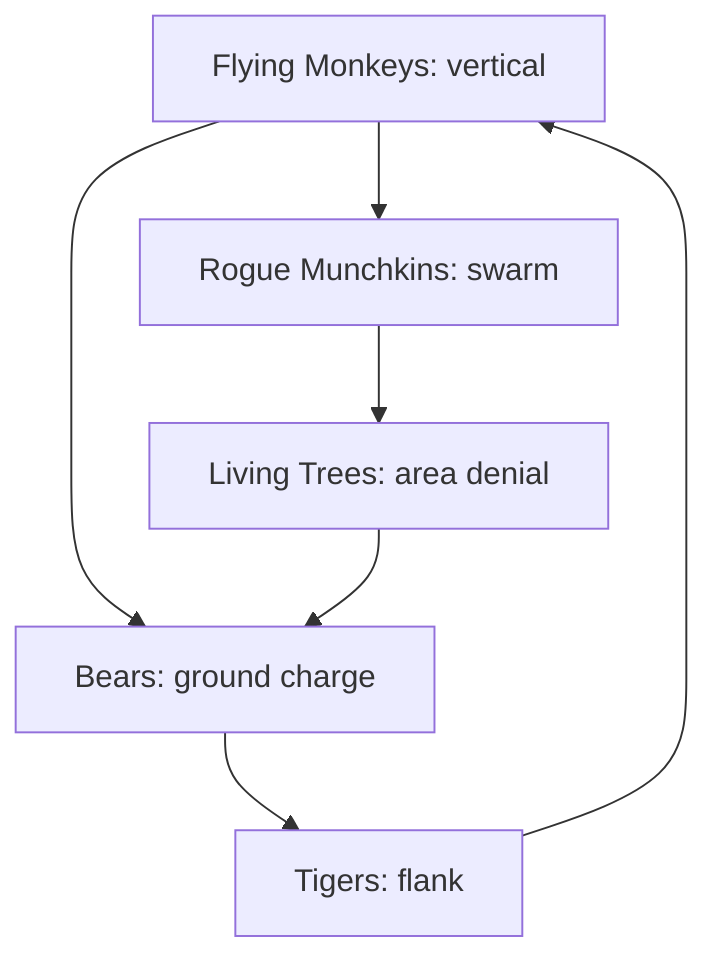

# Enemy Roster

## Roster

| Family | Archetype | Threat | Counter verb | Best friend | Region |
| --- | --- | --- | --- | --- | --- |
| **Flying Monkeys** | Aerial harasser | Dive, grapple, steal item | Blink dodge, Roar scatters | Lion (fear), Scarecrow (crows) | West, Emerald City |
| **Living Trees** | Ambusher / hazard | Root grab, branch sweep | Kick (stagger), Axe (chop) | Tin Man | Munchkinland, Wilds, Winkie |
| **Mangled Lions** | Feral brute | Pounce, pin | Blink, Roar (pacify) | Lion | Wilds |
| **Tigers** | Fast skirmisher | Flank, bleed | Kick (launch), Blink | Scarecrow (confuse) | Wilds |
| **Bears** | Armored charger | Charge, stagger immunity | Oil slick, Axe armor break | Tin Man | Wilds |
| **Rogue Munchkins** | Swarm/trickster | Numbers, traps, slings | Crows, Confuse | Scarecrow | Munchkinland |
| **Winkie Guard** *(proposed)* | Shield wall | Block, formation | Axe, Gilded Edge | Tin Man | Winkie Country |
| **Kalidah** *(proposed)* | Elite predator | One-shot lunge | Perfect blink, Roar | Lion | Wilds (optional) |

## Design Rules

1. **Every family teaches one verb.** Flying monkeys teach dodge; trees teach repositioning; bears teach armor.
2. **Every family has a soft counter and a hard counter.** Soft = any kit; hard = the intended friend.
3. **No enemy is immune to Dorothy.** She can always kick, blink, and disengage.
4. **Elites remix, not inflate.** Elites add a mechanic (shield, aura, summoner), not just HP.
5. **Telegraphs are shape-first.** Color is secondary.

## Threat Triangle

## Encounter Recipes

| Recipe | Composition | Lesson |
| --- | --- | --- |
| **The Welcome Wagon** | 4 rogue munchkins + 1 tree | Taught in Act 1; crows vs. swarm |
| **Bad Air** | 3 flying monkeys + 2 tigers | Blink timing + fear |
| **The Charge** | 2 bears + 1 tiger | Oil slick + armor break |
| **Root and Ruin** | 3 trees + 1 mangled lion | Kick stagger + roar pacify |
| **The Wall** | 4 Winkie guards + 1 archer | Axe + Gilded Edge |
| **Kalidah** | 1 elite + adds | Perfect dodge + burst window |

## Spawn Philosophy

- Never spawn enemies behind the camera in a corridor.
- Always give the player a 1.5 s read before aggression.
- Cap simultaneous attackers at 4; others circle/hold.
- Boss adds are capped at 6 and telegraphed by audio.

## Related

- [[Companion Kits]]
- [[Boss Framework]]
- [[Regions & Level Flow]]
