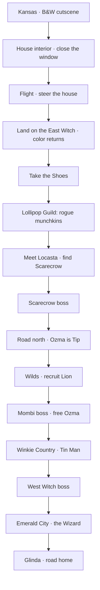

# Main Questline

> **Objective:** Tackle Oz and its antagonistic minions. Get Dorothy home.

## At a Glance

| Act | Quest | Companion | Boss | Outcome |
| --- | --- | --- | --- | --- |
| 0 | [[Q1 - Take the Red Shoes]] (prologue) | — | [[Witch of the East]] (landing) | Arrival in Oz |
| 1 | [[Q1 - Take the Red Shoes]] | — | [[Witch of the East]] | The Shoes |
| 1 | [[Q2 - The Lollipop Guild]] | [[Scarecrow]] | Rogue Munchkin Marshal *(proposed)* | Scarecrow |
| 2 | [[Q3 - Locasta & the Princess]] | [[Cowardly Lion]] | [[Mombi]] | Lion + Ozma freed |
| 3 | [[Tin Man]] arc | Tin Man | Winkie Ironclad *(proposed)* + [[Witch of the West]] | Tin Man + endgame |
| 4 | [[Q4 - Glinda & the Road Home]] | All | [[The Wizard (Boss)]] | Ending |

## Flow

## Act 0 — Kansas Prologue (10–15 min)

- Black-and-white cutscene at the farm; the storm arrives.
- Playable house interior: Dorothy on a canvas, dodging debris, **closing the window**.
- Playable flight: steer the house past obstacles and **aim the landing** at the Witch.
- Impact returns color; hand off to the East Witch set piece.

## Act 1 — Munchkinland (60–90 min)

- Cold open payoff: the curse, the Shoes.
- The Lollipop Guild: free them from rogue munchkin collaborators.
- Meet Locasta; learn the Wizard is a lie; get the Scarecrow.
- Boss: Rogue Munchkin Marshal.
- Exit gate: Shoe Tier 2 + Gillikin road opens.

## Act 2 — Gillikin & the Wilds (2–3 h)

- Locasta protects Ozma; Ozma is hidden as **Tip**.
- Clear the path through the Wilds; recruit the **Lion** among lions, tigers, bears.
- Assault Mombi's manor; free Ozma.
- Boss: **Mombi**.
- Exit gate: Ozma's blessing (meter capacity) + West road opens.

## Act 3 — Winkie Country (2–3 h)

- The regime's industrial heart.
- Free the **Tin Man**; find the oil can; break the Ironclad.
- Climb the Winkie Tower; break the West witch's air power.
- Boss: **Witch of the West**.
- Exit gate: Shoe Tier 4 + Emerald City opens.

## Act 4 — Emerald City & Home (1–2 h)

- Infiltrate the Emerald City; the machine revealed.
- Boss: **The Wizard** (Spectacle → Machine → Man).
- Glinda reveals the Shoes' true purpose.
- Final choice → ending.

## Quest Design Rules

- Every main quest delivers **one verb** and **one truth**.
- No quest requires a companion the player doesn't have.
- Every act ends with a boss that tests the newest kit.
- Side content never gates the critical path.

## Related

- [[Regions & Level Flow]]
- [[Side Quests & Hooks]]
- [[Boss Framework]]
