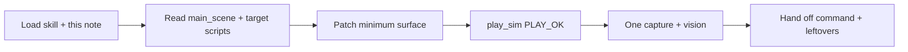

# Agent Token Efficiency

> Every Oz build session spends tokens on **decisions and verification**, not on re-discovering the same Godot pitfalls or re-reading the whole bible.

This note is **mandatory for agents** (Hermes, Claude Code, Codex, etc.) working the Godot prototype at `realdyl/oz` or changing this vault. Humans may skim the one-page card; agents follow the full protocol.

## Summary

Token cost is dominated by: (1) unbounded repo/vault reads, (2) fix–verify thrash without a root-cause check, (3) regenerating large `.tscn` files, (4) prose narration. Maximize efficiency by **loading known pitfalls first**, **touching the smallest surface**, **proving Play with headless scripts**, and **one real-window capture** for framing—not by skipping design checks.

## One-Page Card (pin this)

```
LOAD   godot-4-prototype skill + this note + only the design notes for THIS task
PATHS  code: .../realdyl/oz     bible: .../realdyl/obsidian-oz
PROOF  play_sim.gd → PLAY_OK   then capture_preview.gd + vision once
DON'T  full-file dumps · rebuild landing_square.tscn · camera thrash without CAM_POS/CAM_FWD
DO     patch smallest file · batch independent tools · stop when acceptance is green
```

| Do | Don't |
| --- | --- |
| `skill_view('godot-4-prototype')` before Godot work | Re-learn SpringArm / input / parent= from scratch |
| Read `project.godot` main_scene + the 1–3 scripts you will edit | `find` + read every `.gd` in the tree |
| Cite vault notes by name; open only the section you need | Paste whole [[Art & Audio Direction]] into context |
| `patch` / targeted replace | Rewrite `landing_square.tscn` (50k+) for a one-line fix |
| Headless `play_sim` / `smoke_check` first | "Looks done" without `PLAY_OK` |
| One non-headless capture + one `vision_analyze` | Screenshot loops after every material tweak |
| Print `CAM_POS`, `CAM_FWD`, player pos on camera bugs | 5 guess-and-capture cycles |
| Batch independent tool calls | Serial read → read → read for unrelated files |
| Short status: changed / verified / left | Process diary and tool narration |
| Update this note or the skill when you hit a **new** durable pitfall | Leave the next agent to burn the same tokens |

## Budget Model

Treat a typical slice session as three budgets. If one is blown, stop and re-plan—do not "keep trying."

| Budget | Share | Spend on | Hard stop |
| --- | --- | --- | --- |
| **Orient** | ~15% | Skill + this note + task-scoped files + main_scene/input | Still listing the repo after 2 tool rounds |
| **Build** | ~55% | Patches, scene wiring, one generator run if creating new content | Third full regenerate of the same large scene |
| **Prove** | ~30% | `PLAY_OK`, one capture, optional play window | Third vision pass without a new hypothesis |

> [!warning] Context compression
> Long Godot thrash sessions lose skill text and mid-fix state. After compression: reload `godot-4-prototype` + this note, re-run `play_sim` (do not trust memory of PLAY_OK), then continue. Never replay the whole Orient phase from scratch if `oz/README_DEV.md` and this note still describe the path.

## Orient (cheap, once per session)

### Always load

1. Skill: `godot-4-prototype` (pitfalls, verify commands, collision layers).
2. This note.
3. `oz/project.godot` — only `run/main_scene` + `[input]` action names.
4. The **single** scene/script named in the user task.

### Design bible — pull by task, not by vault

| Task | Open these notes only |
| --- | --- |
| Landing / Munchkinland blockout | [[Regions & Level Flow]] (palette + flow rows), [[Art & Audio Direction]] (Munchkinland + opening color rules), [[IP & Legal]] (silver shoes), skill ref `oz-landing-canon` |
| Dorothy move / blink / kick | [[Movement, Red Shoes & Kick]], [[Core Loop]] |
| Companions / summons | [[Summon System]], [[Companion Kits]] |
| Enemies | [[Enemy Roster]] row for that enemy |
| Boss beat | That boss note + [[Boss Framework]] |
| Prototype scope / week plan | [[Prototype Plan]] |
| Engine / folders | [[Architecture & Pipeline]], [[Tech Stack Decision]] |

> [!note] Control Room
> [[Oz Control Room]] is a map, not a dump. Use it to **name** the next note; do not ingest the whole MOC body every turn.

### Path anchors (do not rediscover)

| What | Path |
| --- | --- |
| Godot project | `.../realdyl/oz` |
| Design SoT | `.../realdyl/obsidian-oz` |
| Main scene (current) | `res://regions/munchkinland/landing_square.tscn` |
| Player | `res://actors/dorothy/player.tscn` + `player_controller.gd` |
| Headless proof | `res://tools/smoke_check.gd`, `play_sim.gd`, `capture_preview.gd` |
| Godot binary (macOS) | `/Applications/Godot.app/Contents/MacOS/Godot` |

## Build (minimum surface area)

### Change hierarchy (prefer top)

1. **One script constant / export** (speed, blink distance, layer).
2. **Small `.gd` logic patch** (camera pitch, input, claim flow).
3. **Packed scene instance props** in the parent `.tscn` (transform, tint).
4. **Player/enemy `.tscn`** local to that actor.
5. **Level `.tscn` surgical edit** (single node block).
6. **Generator script → rewrite level** only when adding a *new class* of content (first landing bake, new region template).

> [!warning] Generated landing
> `landing_square.tscn` is large. Prefer node-level search-replace. If you must regenerate, fix the generator **and** keep `parent="."` for root children; do not hand-edit hundreds of nodes after a regen in the same session.

### Known high-cost failure modes (fix once, then prove)

Memorize via skill; do not experiment blindly:

| Symptom | Likely cause | Cheap probe |
| --- | --- | --- |
| WASD dead | `[input]` keys named `input/move_*` or missing `physical_keycode` | `InputMap.has_action` in play_sim |
| Missing nodes / empty level | `parent="RootName"` instead of `parent="."` | smoke_check find_child |
| Camera on floor / grey ground fill | SpringArm `collision_mask` vs World + downward pitch | print cam y |
| Camera in front of Dorothy | Wrong SpringArm axis mental model; Euler yaw wiped | `CAM_POS` vs player z; skill says **+Z** placement |
| Parse fail on `:=` | Untyped RHS | add `: float` / `: Vector3` |
| Kick no damage | enemy not layer 4 / mask mismatch | print layers; play_sim HP assert |
| Shoes no claim | Area mask not Player (2) | force `_on_body_entered` in sim only if needed, then fix mask |
| Headless shot black/null | dummy renderer | never use `--headless` for capture |

### Parallelism

- **One turn:** batch independent `read_file` / `rg` / status checks.
- **Serialize** only when edit B needs output of edit A (patch then play_sim).
- Prefer one `play_sim` covering move+blink+kick+shoes over four tiny scripts.

### Codebase hygiene that saves tokens later

- Keep acceptance scripts green (`PLAY_OK`) on main.
- Put durable engine lessons in `godot-4-prototype` skill, not in chat.
- Put durable *design* decisions in vault notes; one wikilink from [[Prototype Plan]].
- README_DEV controls table = source for HUD strings; do not invent a second control scheme in chat.

## Prove (mandatory exit)

Do not claim playable until all that apply are checked:

```bash
cd .../realdyl/oz
Godot --headless --path . -s res://tools/smoke_check.gd    # expect SMOKE_OK
Godot --headless --path . -s res://tools/play_sim.gd       # expect PLAY_OK
Godot --path . -s res://tools/capture_preview.gd           # real window; PNG path printed
```

| Gate | Pass condition |
| --- | --- |
| Logic | `PLAY_OK` exit 0 |
| Framing | One vision pass: character + ground treatment + task landmarks (not empty grey plane, not floor-only) |
| Parse | No `SCRIPT ERROR` / parse errors on load |
| Hand-off | main_scene correct; one line how to Play; open issues listed only if blocking |

If vision fails: print camera vectors and fix **one** hypothesis, then **one** recapture. No shotgun material edits.

## Session shapes

### A — "Make X playable" (feel slice)



### B — Design-only (vault)

- Edit the one note; frontmatter + wikilinks.
- No Godot launch.
- Link from Control Room or parent MOC only if structure changed.

### C — Debug regression

1. Repro with play_sim or minimal print script (cheaper than chat speculation).
2. Map symptom → table above.
3. Patch + play_sim; capture only if visual.

### D — New region / large content

1. Spike a *small* packed scene or generator in `tools/`.
2. smoke_check instantiate.
3. Only then promote to main_scene.
4. Do not grow `landing_square.tscn` into the whole Act 1 map—silhouette other regions per [[Regions & Level Flow]].

## What not to put in context

- Full `landing_square.tscn` body
- Binary `.png` / `.import` dumps
- Entire `obsidian-oz` tree listings every turn
- Unrelated monorepo projects under `realdyl/`
- Long agent transcripts from prior sessions (use this note + skill + git diff)

## Hand-off template (copy)

```markdown
## Oz hand-off
- Goal:
- Changed: (paths only)
- Verified: PLAY_OK / SMOKE_OK / capture (yes/no)
- main_scene:
- Leftover blockers:
- Design notes touched:
```

## Maintenance

| When | Where to write |
| --- | --- |
| New Godot footgun | `godot-4-prototype` skill pitfalls + row in this note's failure table |
| New design lock | Relevant vault note; status → stable |
| main_scene or control change | `oz/README_DEV.md` + one line here under Path anchors if permanent |
| Token strategy change | This note `updated` date + Decision Log below |

## Decision Log

| Date | Decision |
| --- | --- |
| 2026-11-05 | Agents must load this note + godot-4-prototype before Oz Godot execution |
| 2026-11-05 | Proof order fixed: headless play_sim before capture/vision |
| 2026-11-05 | SpringArm +Z placement and no floor pin are skill-canonical; do not re-litigate in chat |

## Related

- [[Prototype Plan]]
- [[Architecture & Pipeline]]
- [[Oz Control Room]]
- [[Tech Stack Decision]]
- [[IP & Legal]]
- [[Regions & Level Flow]]
- [[Movement, Red Shoes & Kick]]
- [[Design Note Template]]
- [[GUI & UX Roadmap]] — polish phase only when founder unlocks; do not thrash spine sessions on chrome
