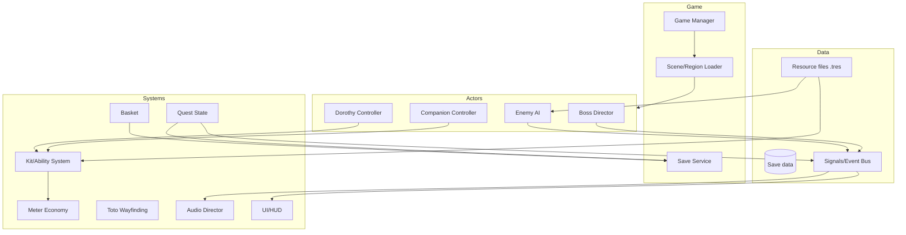

# Architecture & Pipeline

## High-Level Architecture (Godot 4.5)



## Core Modules

| Module | Responsibility | Godot approach |
| --- | --- | --- |
| **Dorothy Controller** | Movement, blink, kick, camera | `CharacterBody3D` + state machine |
| **Companion Controller** | Follow/hold/engage, kit execution | `CharacterBody3D` + behavior tree |
| **Kit/Ability** | Data-driven abilities, costs, cooldowns | `Resource`-based ability definitions |
| **Meter Economy** | Brain/Heart/Courage, regen rules | Autoload service |
| **Enemy AI** | Perception, telegraph, attack patterns | State machine + `NavigationAgent3D` |
| **Boss Director** | Phases, arena events, checkpoints | Scripted scene + signals |
| **Quest State** | Flags, objectives, gating | Autoload + save service |
| **Basket** | Inventory, stacks, quest items | Autoload + UI scene |
| **Toto Wayfinding** | Lost detection, trail rendering | Autoload + decal/mesh trail |
| **Save Service** | Checkpoints, settings, progress | JSON/`ConfigFile` per slot |
| **Audio Director** | Music states, SFX ducking | Bus layout + event triggers |

## Data-Driven Abilities

Each ability is a `Resource`:

```
AbilityData
  id: StringName
  display_name: String
  companion: enum
  input: enum
  cost: int
  cooldown: float
  cast_time: float
  range: float
  telegraph: PackedScene
  effect: PackedScene
  upgrades: Array[UpgradeData]
```

Designers tune in the inspector; no code changes for balance.

## Scene Structure

```
res://
  actors/
    dorothy/
    companions/scarecrow/ tinman/ lion/
    enemies/flying_monkey/ living_tree/ ...
    bosses/east_witch/ mombi/ west_witch/ wizard/
  systems/
    abilities/ meter/ inventory/ wayfinding/ quests/
  regions/
    munchkinland/ gillikin/ wilds/ winkie/ emerald_city/
  ui/
  audio/
  data/
    abilities/*.tres
    enemies/*.tres
    quests/*.tres
```

## Pipeline

| Stage | Tool | Notes |
| --- | --- | --- |
| Modeling | Blender | Stylized, ~2k–8k tris for characters |
| Rigging/Animation | Blender | Shared humanoid rig for Dorothy/companions |
| Texturing | Substance Painter / Blender | Hand-painted stylized |
| Import | glTF 2.0 | One material per character where possible |
| Level blockout | Godot CSG / Blender | Greybox in-engine |
| Audio | Reaper / FMOD (optional) | Godot buses for v1 |
| Version control | Git + Git LFS | Text scenes diff well |

## Performance Targets

| Target | Value |
| --- | --- |
| Frame rate | 60 fps on mid PC / Steam Deck |
| Draw calls | < 2,000 per frame |
| Simultaneous enemies | ≤ 12 (4 active attackers) |
| Load time | < 5 s per region (SSD) |
| Memory | < 4 GB |

## Save Data

- 3 slots + autosave.
- Stores: quest flags, region unlocks, upgrades, basket, discovered shrines, settings.
- Versioned schema with migration hooks.

## Related

- [[Tech Stack Decision]]
- [[Prototype Plan]]
- [[Art & Audio Direction]]
