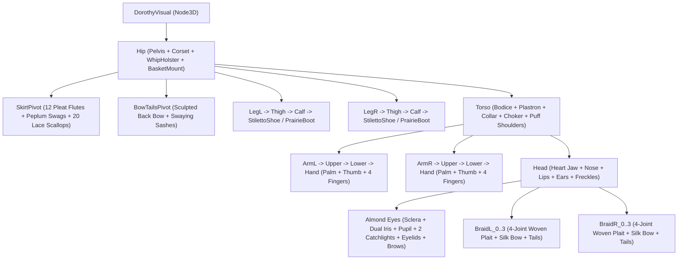

# Phase P8.2 — Dorothy 2026 Flagship Character & Dynamic Sky Architecture

> [!IMPORTANT]
> **Character Design Benchmark**: `oz/actors/dorothy/dorothy_visual.gd` establishes the **2026 Stylized AAA Procedural-Shader Character Standard** for *Oz: The Road Home*. Subsequent hero and companion overhauls (Scarecrow, Tin Woodman, Cowardly Lion, Toto, Locasta, Glinda, Wicked Witch) must replicate this exact anatomical, shader, secondary-physics, and Couture-switching architecture.

---

## 1. Dynamic Volumetric Cloud & Seasonal Weather Sky System

### Shader: `oz/ui/shaders/oz_dynamic_sky.gdshader` (`shader_type sky`)
Replaces flat `BG_COLOR` and bare sky gradients across all seven Acts (`L1–L7`) with a real-time multi-layer GPU sky dome (`WorldKit.apply_sky_and_weather` / `WorldKit.apply_sky_and_weather_to_env`):

1. **Multi-Stop Atmospheric Rayleigh Gradient**: Smooth zenith → mid-dome → horizon → ground-bounce hemisphere blending with Mie forward-scattered sun/moon halo and crisp celestial disk.
2. **High-Altitude Swept Cirrus Layer (`cirrus_amount`)**: Stretched anisotropic FBM streaks drifting on an independent upper-troposphere wind vector.
3. **Self-Shadowed Volumetric Cumulus / Stratocumulus (`cloud_coverage`)**:
   - Curved dome UV projection (`rd.xz / (rd.y + 0.20)`) prevents horizon pinching and yields authentic aerial perspective.
   - Domain-warped 5-octave FBM cumulus silhouettes with **sun-offset directional self-shadowing** (`cloud_lit_col` vs. `cloud_shadow_col`) and silver/golden-lining rim scattering near the sun.
4. **Live Seasonal & Weather Variation**:
   - **Organic Weather Tide**: `weather_variance` and `weather_cycle_speed` gently breathe cloud cover between clearer sunlit windows and richer cloud banks.
   - **Kansas Cyclone Progression (`WorldKit.set_sky_storm_factor`)**: Dynamically transitions Act 0 (`farmyard.gd`) from crisp prairie cirrus (`cloud_coverage = 0.44`) through darkening shutter/cellar gusts into boiling charcoal supercell storm clouds (`cloud_coverage = 0.88`) with internal sheet-lightning flashes!

| Act / Biome | Preset ID | Seasonal / Atmospheric Profile | Special Sky Phenomena |
| --- | --- | --- | --- |
| **Act 0 · L1 Kansas** | `kansas` | Late-spring sepia-monochrome prairie (`cirrus = 0.48`, `cov = 0.44 → 0.88`) | Live cyclone storm thickening + internal lightning |
| **Act I · L2 Munchkinland** | `munchkin` | Enchanted spring-twilight cerulean-to-peach dome (`cov = 0.40`) | Golden-rimmed storybook cumuli + early twilight stars + faint emerald horizon aurora |
| **Act II · L3 Poppy Field** | `poppy` | Late-summer narcotic crimson-plum dusk (`cov = 0.46`) | Rose-lit drifting stratocumulus + warm scarlet Mie haze |
| **Act III · L4 Winkie Castle** | `winkie` | Brooding autumn fortress storm overcast (`cov = 0.68`) | Turbulent slate-violet storm banks + cloud-to-cloud lightning |
| **Act IV · L5 Emerald City** | `emerald` | Regal teal-obsidian evening dome (`cov = 0.42`) | Jade-uplit cathedral clouds + shimmering Emerald Aurora |
| **Act V · L6 Glinda's Court** | `glinda` | High-summer Quadling golden hour (`cov = 0.35`) | Apricot-rose sunbeams + cream-and-blush cumulus puffs |
| **Act VI · L7 Homecoming** | `homecoming` | Post-storm clearing monochrome prairie (`cov = 0.36`) | Silver-lined breaking cloud banks + calm sun halo |

---

## 2. Flagship Character Rig: Dorothy Gale (`dorothy_visual.gd`)

### Anatomical & Shader Highlights (Zero Blocky Primitives)
- **Sculpted 2026 Face**: Contoured cranium + heart-shaped jaw/chin taper, upturned nose bridge/tip, inner/outer ears with silver/ruby stud earrings, rosy cheekbones with prairie freckles, Cupid's-bow upper lip & full lower lip, almond sclera, dual-ring slate-cerulean irises, pupils, twin white specular catchlights, curved upper lashes, **autonomous blinking eyelids (`_eyelid_l/r`)**, and **combat-reactive eyebrows (`_brow_l/r`)**.
- **Custom Spatial Couture Shaders**:
  - `_make_gingham_material`: 3-tone woven royal-blue & ivory gingham check with 260× linen micro-thread weave and Fresnel rim sheen.
  - `_make_velvet_material`: Anisotropic crushed plum/crimson velvet with directional Fresnel nap sheen.
  - `_make_satin_material`: Iridescent moonlit lavender-silver satin with embedded starlight micro-glints.
- **5 Authentic Outfit Configurations via `set_outfit(id)`** (eliminates brute-force mesh tinting on skin/eyes in both `ShopMenu` and `SaveManager`):
  1. `kansas_pinafore` (`greyscale && !show_silver_shoes` — `char_07_dorothy_kansas.jpg`): Sepia gingham pinafore apron with patch pocket, rolled-sleeve prairie blouse, ruffled straps, and scuffed lace-up leather prairie boots.
  2. `dorothy_gingham` (`char_05_dorothy_seeker.jpg`): Royal-blue gingham gown, tucked ivory plastron with pearl buttons, high ruffled lace collar, plum velvet cameo choker, plum velvet corset with gold filigree buckle & back lacing, 12-pleat skirt + 20 lace hem scallops, diamond-fishnet stockings, and sculpted Silver Shoes with instep filigree buckles.
  3. `dorothy_velvet` (`char_03_dorothy_red_seeker.jpg` & `shop_dorothy_velvet.png`): Deep crimson & obsidian velvet corset with gold front X-lacing & key choker, gold-fringed crimson puff sleeves, draped crimson bustle with golden rose clasps over black lace petticoats, silver lace-up heeled boots, and hip-holstered Lace Whip.
  4. `dorothy_sovereign` (`shop_dorothy_sovereign.png`): High standing Elizabethan scalloped silver-lace collar, silver starburst necklace, iridescent lavender-silver satin corset, starlight-laced high-low overskirt, and mirror-silver stilettos.
  5. `dorothy_whip_plus` (`shop_dorothy_whip_plus.png`): Seeker couture + ornate engraved-brass knuckle-bow hilt, coiled crimson silk cord, and glowing faceted ruby crystal tip mounted at her right hip.

---

## 3. Dexterity, Secondary Physics, Whimsy & Fighting Choreography

- **Secondary Procedural Physics (`_update_secondary_physics`)**:
  - 4-joint shoulder braids (`_braid_l_joints`, `_braid_r_joints`), dynamic skirt flare (`_skirt_piv`), and back bow sashes (`_bow_tails_piv`) lag, flare, and whip smoothly in response to sprint velocity, turn rate, jumps, spins, and kicks.
- **Turn Banking, Airborne Pose & Landing Cushion (`player_controller.gd`, `kansas_controller.gd`)**:
  - `visual.rotation.z` banks naturally into sharp turns; `set_airborne` drives mid-air jump/float leg tuck and soft knee/skirt cushion on landing.
- **Whimsical Silver-Shoe Heel-Click Flourish (`play_heel_click`, auto-idle or `[V]` key)**:
  - Rises onto her toes and taps both gleaming Silver Shoes together three times with a subtle head tilt and starlight ring.
- **3-Stage Martial Arts Stiletto Kicks (`play_combo_kick(1..3)`)**:
  - **Hit 1 (`10 dmg`)**: Snappy hip-pivoted front-roundhouse stiletto kick.
  - **Hit 2 (`14 dmg`)**: Full `360°` balletic spinning back-heel sweep.
  - **Hit 3 (`22 dmg`)**: Leaping starlight pirouette crescent finisher + `CombatFx.combo_finisher_burst`.
- **Silver-Shoe Blink Afterimage (`CombatFx.blink_afterimage` + `play_blink`)**:
  - Leaves a shimmering translucent silver-cerulean silhouette of Dorothy at her departure point + 6 starlight heel-sparks along her dash vector.
- **Armament Cast Choreography (`play_cast(0..3)`)**:
  - Distinct upper-body/pirouette animations for Lace Whip crack, Silk Bindings cast, Hypnotic Perfume ballerina twirl, and Gilded Chain snap.
- **Live Boutique Turntable (`oz/ui/shop_menu.gd`)**:
  - `_process(delta)` drives live breathing, eye blinking, curious head glances, braid sway, and occasional heel-clicks on the 3D Boutique spotlight pedestal while previewing true `set_outfit` geometry.
