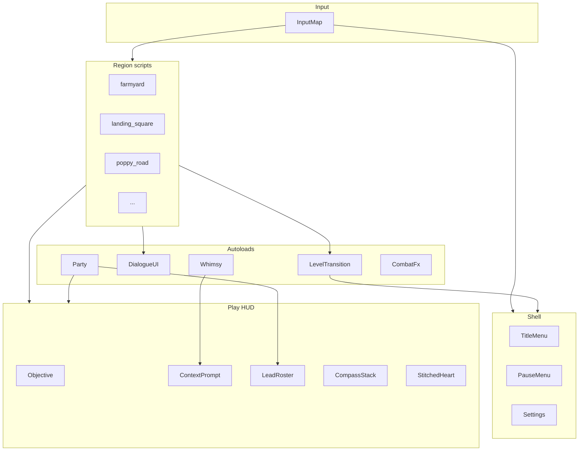

# GUI & UX Roadmap

> Handoff document for a future agent (or a later phase of this one): **significantly enhance the GUI and overall UX** of *Oz: The Road Home* once the playable spine is locked and the founder is ready for the polish phase.

This note is **design SoT for UI/UX work**. Code lives in `realdyl/oz`. If code and this note disagree, **stop and say so** — do not silently invent a second control scheme or a sci-fi HUD.

---

## Phase gate (do not start early)

| Gate | State (as of 2026-11-06) | Rule |
| --- | --- | --- |
| Playable L1–L7 spine | Shipped prototype | GUI polish was **explicitly deferred** until spine stable ([[Oz Control Room]] decision 2026-11-05). |
| Founder says “GUI phase” | **Not yet** until they unlock it | Do not burn a spine/debug session on chrome. Logic before menus. |
| Token budget | [[Agent Token Efficiency]] | One theme pass at a time; verify headless + one capture; no full scene rewrites for cosmetics. |

**Start trigger (founder):** phrases like “GUI phase,” “polish the HUD,” “menus,” “UX pass,” or “ship feel.” Until then, only fix **clarity bugs** that block play (wrong prompt priority, invisible FINAL STEP, silent Tab).

---

## Design pillars (non-negotiable)

From [[Art & Audio Direction]], [[Vision & Pillars]], [[Accessibility & Difficulty]], [[IP & Legal]]:

1. **Storybook, not sci-fi.** Paper texture, hand-drawn icons, stitched hearts. No holographic grids, no military FPS chrome, no damage-number spam by default.
2. **Diegetic first.** Toto is the living compass long-term ([[Dorothy & Toto]], [[Basket & Toto Wayfinding]]). UI should support the world, not replace it.
3. **Home colors everything.** Even chrome should feel like a scrapbook / prairie letter / Oz playbill — grey Kansas vs candy Oz is a **mode**, not two games.
4. **Lead, not Possess.** Party UI says **Lead** ([[Party Control and the Bond]]). Shoes stay on Dorothy always.
5. **Silver shoes** (book). Never ruby slippers / film trade dress.
6. **Accessibility is pillar-level.** Scale, contrast, captions, remap — bake hooks early in G1, not as a G5 apology.
7. **Arrows primary** move; README_DEV / HUD controls strings stay one source of truth.
8. **No portals.** Level transitions are hourglass / road / gate / heels — UI must name **FINAL STEP** clearly.

---

## What exists today (prototype inventory)

Agents must extend these APIs rather than forking parallel HUDs.

### Code map (`oz/`)

| Piece | Path | Role |
| --- | --- | --- |
| Play HUD | `ui/play_hud.gd` + `play_hud.tscn` | CanvasLayer: objective paper, context prompt, controls strip, party roster, threat compass, Fade rect, `set_kansas_mode` |
| Dialogue | Autoload `DialogueUI` | Bottom speaker/body panel; `say` / `say_line`; optional OS TTS; future VO bank plugs here |
| Hourglass | Autoload `LevelTransition` | Brief begin/end sting; `on_level_start` / `go_to` / `play_exit` |
| Whimsy score | Autoload `Whimsy` | Optional side score; `setup` after HUD; `try_collect` / `prompt_if_near` |
| Party | Autoload `Party` | Lead swap; failed Tab must surface a **HUD reason** |
| Combat FX | Autoload `CombatFx` | Kit VFX labels (CAW / ROAR / AXE) — not floating DPS meters |
| Per-level compass | Often local `Label` on HUD | Objective compass (ahead/left/right/behind + m). Kansas + each region may add their own |
| Poppy sleep HUD | Local label on L3 | Flesh sleep meters (Dorothy · Lion) — pattern for future meters |
| World labels | `Label3D` | Interact names, FINAL STEP, rescue markers — billboard enabled |
| Input | `project.godot` `[input]` | Arrows primary; E interact; F/kick act; Tab / 1–4 Lead |

### HUD API contract (keep stable)

```text
PlayHUD.set_objective(text)
PlayHUD.set_prompt(text)          # empty hides
PlayHUD.set_kansas_mode(bool)     # B&W strip; hides Oz combat roster/threat
PlayHUD.set_party_roster(text)
# group "hud" for discovery
```

```text
DialogueUI.say(speaker, body, block?, duration?)
DialogueUI.say_line(line, block?)
# future: DialogueUI.speak(clip_id) / set_tts_enabled
```

```text
LevelTransition.on_level_start(title)
LevelTransition.go_to(scene_path, msg, subtitle)
```

**Rule:** Region scripts call these. Do **not** hardcode a second bottom bar in every level. New chrome = new methods on PlayHUD / thin child scenes, then wire levels.

### Regional UX modes

| Mode | When | Feel |
| --- | --- | --- |
| `kansas_mode` | L1 farmyard, L7 homecoming | Grey paper; no Lead roster; no threat compass; no blink/kick kit chrome |
| Oz full | L2–L6 | Candy paper; Lead roster; threat compass; kit controls line |
| Poppy special | L3 | Dual flesh sleep readout + rescue 1/3–3/3 objectives (Clear Air · Cart · Lion) |

---

## Current UX debt (fix before paint)

Clarity bugs beat beauty. Known classes:

| Debt | Symptom | Direction |
| --- | --- | --- |
| Prompt priority | E enters building instead of talking to NPC | Story NPC > story prop > optional enter > whimsy (Kansas fixed 2026-11-06) |
| Overlapping interact volumes | Porch + door same sphere | Separate exterior door pads; tight radii; labeled plates |
| Lead-only meters | Follower flesh ignored sleep | Body-position meters (Poppy pattern) |
| Silent fail | Tab / F do nothing visible | Always HUD reason + VFX |
| FINAL STEP unclear | Player walks past end-gate | Objective string must include **FINAL STEP**; world label + pad glow |
| Compass sprawl | Objective + threat + level labels compete | G2: one CompassController with layers |
| Controls string drift | HUD vs README vs chat | Single `ControlsCopy` resource or README_DEV as SoT |
| Hardcoded bounds in threat compass | L2 expanded maps wrong | Read `PLAY_BOUND_*` from level or Party |
| No pause / settings | Esc only releases mouse | G1 shell |
| No quest log | Objective is one line only | G2 journal (plain language) |
| No health UI | Prototype relies on fail-soft / fight feel | G2 stitched heart when combat is scored |
| Basket not inventory UI | Basket is world prop | G3 basket close-up panel ([[Basket & Toto Wayfinding]]) |

---

## North-star player experience

A player who never reads a design doc should always know:

1. **Where to go** (compass + Toto later + YBR).
2. **What to press** (context prompt, one verb).
3. **Who leads** (roster + portrait).
4. **When the level ends** (FINAL STEP wording).
5. **Why Tab failed** (plain reason).
6. **That home is the point** (Glinda / shoes language, not balloon-as-Dorothy-ride).

Kansas should feel lonely and paper-dry. Oz should feel like opening a colored book. Transitions should feel like turning a page (hourglass), not loading a modern game.

---

## Roadmap phases

### G0 — Freeze & inventory (1 short pass)

**Goal:** Safe baseline for polish agents.

- [ ] Confirm L1–L7 smoke tokens green (`SMOKE_OK`, `KANSAS_OK`, `PLAY_OK`, `POPPY_OK`, …).
- [ ] Snapshot current HUD screenshots (Kansas + Munchkin combat + Poppy rescue + dialogue open).
- [ ] List every `set_objective` / `set_prompt` string class (story · combat · FINAL STEP · skip keys).
- [ ] Document input map once in `oz/README` or `README_DEV` and link here.
- [ ] Mark this note `status: active` and Control Room “GUI phase unlocked” when founder starts.

**Exit:** Inventory complete; no new systems yet.

### G1 — Shell & readability (foundation)

**Goal:** Playable chrome that does not fight the prototype.

| Deliverable | Detail |
| --- | --- |
| Theme tokens | Godot `Theme` resource: fonts, paper colors, Kansas grey vs Oz candy, focus colors |
| HUD layout grid | Safe margins; objective top; prompt bottom-center; controls bottom; no overlap at 1280×720 and 1920×1080 |
| Dialogue panel v2 | Paper frame, speaker nameplate, advance hint (E), optional portrait slot, subtitle background |
| Pause shell | Esc → pause (mouse free); Resume · Settings stub · Reload last checkpoint (optional) · Quit to desktop |
| Settings stub | Master volume, mouse sens, Y invert, UI scale, subtitles on/off, TTS on/off |
| Prompt priority service | Central resolver: `InteractPriority` enum so levels do not re-bug porch/door |
| FINAL STEP treatment | Distinct icon/color on objective when string contains `FINAL STEP` |
| Kansas / Oz theme swap | Drive from `set_kansas_mode` + optional `set_region_palette(id)` |

**Do not:** Full main menu cinematic, shop, skill trees.

**Verify:** Pause works on L1 and L2; dialogue readable; no interact priority regressions (`kansas_sim` + play_sim).

### G2 — Combat & party clarity

**Goal:** Bond and fights readable without a wiki.

| Deliverable | Detail |
| --- | --- |
| Lead roster widget | 1–4 slots: Dorothy · Scarecrow · Tin Man · Lion; locked silhouette until unlocked; active Lead frame |
| Kit verb chip | Shows current Lead’s F verb (KICK / CAW / ROAR / AXE) with icon |
| Stitched heart HP | Dorothy (and optional Lead) health as heart stitches — no numeric FPS bar by default |
| Companion meters | Brain / Heart / Courage as storybook icons when summon/resource systems land ([[Companion Kits]], [[Summon System]]) |
| Threat compass v2 | Uses live play bounds; marshal vs wave kinds; colorblind shape, not color alone |
| Objective compass unified | One controller; layers: story target, threat, optional Toto |
| Damage feedback | Screen edge stitch pulse optional; default **off** for numbers |
| Failed-swap toast | Dedicated short toast region (not only prompt overwrite) |

**Verify:** Lead swap visible; kit chip updates; headless still `PLAY_OK`; capture shows roster + heart.

### G3 — Diegetic systems UI

**Goal:** Basket, wayfinding, whimsy, shops — in-world fantasy.

| Deliverable | Detail |
| --- | --- |
| Basket panel | Literal basket close-up inventory ([[Art & Audio Direction]]); quest items as objects in weave |
| Toto wayfinding | Optional trail / sniff marks; settings can enable auto-waypoint assist ([[Accessibility & Difficulty]]) |
| Whimsy counter | Small optional badge (never story-gated); regional glyph skins |
| Interact glyphs | Consistent E / F / Tab icons in world and HUD |
| Building enter/exit | Fade micro-sting + location title (“Gale kitchen”) without stealing NPC talk |
| Quest recap | “What was I doing?” on pause — plain language from last objective + act name |
| Hourglass art | Replace procedural placeholder with storybook hourglass + region title card |

**Verify:** Basket open/close; pause recap accurate per level; whimsy still optional.

### G4 — Meta flow & narrative presentation

**Goal:** First boot and act structure feel authored.

| Deliverable | Detail |
| --- | --- |
| Title card | Working title *Oz: The Road Home*; B&W prairie → color bloom teaser (not film stills) |
| Main menu | Continue · New · Settings · Credits · Quit |
| Save slots | 3 slots; show act/region name + playtime |
| Act cards | Short paper card on region enter (already partially `on_level_start`) |
| Dialogue choices | Only if design adds them; no timed choices ([[Accessibility & Difficulty]]) |
| Credits | Baum PD acknowledgment; original work; no MGM song titles |
| Ending sting UI | L7 epilogue full-screen paper; shoes motif; no Dorothy-in-balloon |

**Verify:** New game → L1; continue restores; credits legal-safe.

### G5 — Delight, accessibility depth, ship feel

**Goal:** Premium single-player baseline.

| Deliverable | Detail |
| --- | --- |
| Full a11y panel | UI scale 80–150%, high contrast, reduce flash/shake, mono audio, remap, hold vs toggle |
| Subtitles | Size, background, speaker colors; directional captions for threats |
| Controller prompts | Dynamic keyboard vs gamepad glyphs |
| Photo mode / scrapbook (optional) | Non-blocking; never required |
| Localization hooks | String table for HUD/dialogue (EN first) |
| Performance HUD off by default | No debug unless dev flag |
| Juice pass | Button hover, page-turn sfx, soft paper crinkle — restrained |

**Verify:** A11y checklist in [[Accessibility & Difficulty]]; 3 profiles playtested before content lock.

---

## Component build list (implementation checklist)

Use this as a ticket board. Prefer **one shared UI autoload or `ui/` package** over per-level copies.

### Core

- [ ] `ui/theme/oz_theme.tres` — fonts, colors, panel styles
- [ ] `ui/theme/kansas_theme.tres` — grey variant
- [ ] `ui/play_hud.tscn` redesign (keep script API)
- [ ] `ui/widgets/objective_banner.tscn`
- [ ] `ui/widgets/context_prompt.tscn`
- [ ] `ui/widgets/controls_strip.tscn`
- [ ] `ui/widgets/lead_roster.tscn`
- [ ] `ui/widgets/kit_verb_chip.tscn`
- [ ] `ui/widgets/stitched_heart.tscn`
- [ ] `ui/widgets/compass_stack.tscn` (story + threat)
- [ ] `ui/widgets/toast.tscn` (failed Tab, tips)
- [ ] `ui/dialogue/dialogue_panel.tscn` (backed by DialogueUI)
- [ ] `ui/shell/pause_menu.tscn`
- [ ] `ui/shell/settings_menu.tscn`
- [ ] `ui/shell/title_menu.tscn`
- [ ] `ui/shell/save_slots.tscn`
- [ ] `ui/systems/basket_panel.tscn`
- [ ] `ui/systems/quest_recap.tscn`
- [ ] `ui/fx/hourglass_overlay.tscn` (LevelTransition visual)
- [ ] `ui/fx/act_title_card.tscn`
- [ ] `systems/interact_priority.gd` or HUD helper
- [ ] `systems/controls_copy.gd` — single string SoT for HUD

### Art/audio dependencies (can be placeholders)

- Paper nine-slice
- Ink fonts (readable at 16–22px)
- Icons: brain, heart, courage, shoes, basket, lead crown/pin
- SFX: page turn, soft select, pause open (no UI bleep sci-fi)

---

## Per-level UX acceptance (agent checklist)

When polishing a level, tick these. Spine logic must still pass headless.

| Level | Must show clearly | Kansas mode? |
| --- | --- | --- |
| L1 Kansas | Basket → Toto → Aunt talk (not enter house) → shutter → cellar → storm FINAL door | Yes |
| L2 Munchkin | Locasta before house; YBR south; Lead unlocks; threat compass; gate → Poppy FINAL | No |
| L3 Poppy | Dual sleep; Clear Air 1/3; Cart 2/3; Lion E 3/3; Dorothy parked south; West FINAL | No |
| L4 West | Weaken → GROUNDED → cistern water → douse; open YBR north Emerald | No |
| L5 Emerald | Hall, curtain, humbug; exit toward Glinda | No |
| L6 Glinda | Counsel; Road Home pad E×3 heels (not balloon ride) | No |
| L7 Home | Aunt; porch FINAL; B&W; epilogue | Yes |

---

## Copy & tone guide

| Surface | Tone | Example |
| --- | --- | --- |
| Objective | Clear, second person or bare imperative; include FINAL STEP when true | `FINAL STEP (L3): Follow the YBR south to the West gate — E.` |
| Prompt | Short; lead with key | `E  —  Talk to Aunt Em` |
| Failed Lead | Honest reason | `Lion won't lead while asleep in the poppies.` |
| Dialogue | Character voice; Baum-true; no film song quotes | Aunt Em prairie plain speech |
| Skips | Documented, not hidden | `F9 → Munchkinland` on Kansas controls |

**Banned UI copy patterns:** “Press E to win,” “Portal unlocked,” “Possess companion,” “Ruby slippers,” “Tower of Oz” (use Emerald City / Wizard’s palace).

---

## Architecture notes for implementers



**Rules:**

1. Region scripts remain thin: set beat → `hud.set_objective` / DialogueUI / transition.
2. Visual redesign happens in `ui/` scenes + Theme; scripts keep method names.
3. Autoload bare names may fail under `Godot -s` — tools use `root.get_node_or_null`.
4. Never strip Clerk-like external systems here (N/A); never strip Party/Shoes rules for a prettier HUD.
5. Headless sims must still find PlayHUD / objectives without relying on visible texture.

---

## Verification protocol (GUI phase)

Mirror [[Agent Token Efficiency]] + godot-4-prototype skill:

1. **Logic first** — existing `*_sim.gd` / `smoke_check.gd` still print OK tokens.
2. **API smoke** — tiny test: `set_objective`, `set_prompt`, `set_kansas_mode`, DialogueUI.say, pause open/close.
3. **One real-window capture** per major chrome change; `vision_analyze` for contrast/overlap.
4. **Interact priority tests** — Aunt Em E must not teleport; Poppy Clear Air / Cart / Lion order; West water beat labels.
5. **A11y spot-check** — UI scale 150% and 80%; high contrast; no essential info by color alone.
6. **Vault** — append [[Prototype Progress Log]]; update this roadmap checkboxes; [[Auto Git Policy]] both repos.

---

## Out of scope (unless founder expands)

- Live service / online menus
- Microtransaction shop UI (Outfit Shop design may exist — implement only if quest-scoped)
- Film-accurate ruby/MGM chrome
- Replacing YBR wayfinding with a full-screen map as the only guide
- Damage-number esports mode as default
- Reworking L1–L7 story order under the guise of “UX”

---

## Handoff blurb (paste to a new agent)

```text
Vault SoT: obsidian-oz. GUI work starts at [[GUI & UX Roadmap]].
Code: realdyl/oz — extend ui/play_hud.gd API + DialogueUI + LevelTransition; do not fork HUDs.
Pillars: storybook paper UI, silver shoes, Lead not Possess, Kansas B&W mode, no sci-fi HUD, a11y pillar.
Gate: founder unlocked GUI phase; spine L1–L7 already playable — do not regress beats for chrome.
Verify: headless OK tokens + one capture; interact priority (NPC talk > building enter).
Read: Art & Audio Direction (UI), Accessibility & Difficulty, Party Control and the Bond, Agent Token Efficiency.
IP: Baum PD; no MGM trade dress.
```

---

## Related

- [[Art & Audio Direction]] — UI visual pillars
- [[Accessibility & Difficulty]] — options matrix
- [[Party Control and the Bond]] — Lead UI language
- [[Basket & Toto Wayfinding]] — diegetic compass / inventory
- [[Architecture & Pipeline]] — UI in stack diagram
- [[Prototype Plan]] — earlier “basic HUD” milestone
- [[Milestones & Backlog]] — backlog ticks
- [[Prototype Progress Log]] — what shipped in code
- [[Agent Token Efficiency]] — how to execute without thrash
- [[Oz Control Room]] — unlock decision
- [[IP & Legal]] — what UI must never evoke

---

## Open questions (UI-specific)

Record resolutions in [[Open Questions]] when locked:

1. Font licensing (hand fonts vs Godot defaults for prototype vs ship).
2. Controller support priority vs KB/M-first.
3. Whether Toto ever fully replaces the HUD compass (diegetic purity vs clarity).
4. Save system scope for vertical slice vs 1.0.
5. How much of Summon System meters appear before summon is fully built.
