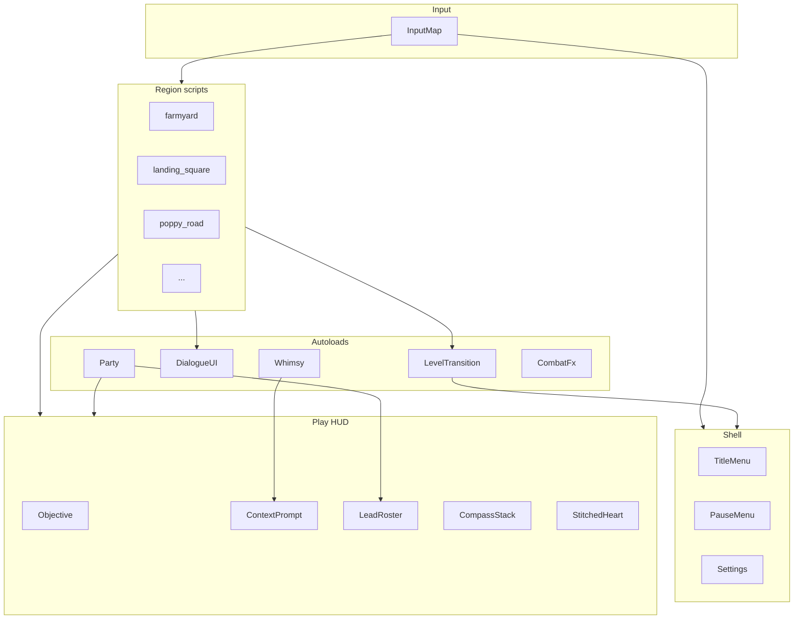

# GUI & UX Roadmap

> Handoff document for a future agent (or a later phase of this one): **significantly enhance the GUI, presentation, and overall UX** of *Oz: The Road Home* once the playable spine is locked and the founder is ready for the polish phase.

This note is **design SoT for UI/UX and ship-facing presentation work**. Code lives in `realdyl/oz`. If code and this note disagree, **stop and say so** — do not silently invent a second control scheme or a sci-fi HUD.

**Founder lock (2026-11-06):** The prototype’s primitive meshes are **scaffolding only**. Ship target is a **real stylized 3D game**, not a Minecraft-like block/voxel look, not “greybox forever with labels.” GUI phase includes **world presentation + camera + lighting + character/prop art path**, not only 2D HUD chrome. See [[Art & Audio Direction]] and the **Visual north star** section below.

---

## Phase gate (do not start early)

| Gate | State (as of 2026-11-06) | Rule |
| --- | --- | --- |
| Playable L1–L7 spine | Shipped prototype | GUI polish was **explicitly deferred** until spine stable ([[Oz Control Room]] decision 2026-11-05). |
| Founder says “GUI phase” | **Not yet** until they unlock it | Do not burn a spine/debug session on chrome. Logic before menus. |
| Token budget | [[Agent Token Efficiency]] | One theme **or** one presentation pass at a time; verify headless + one capture; no full scene rewrites for cosmetics in a spine debug turn. |

**Start trigger (founder):** phrases like “GUI phase,” “polish the HUD,” “menus,” “UX pass,” “ship feel,” “looks like a real game,” or “visual upgrade.” Until then, only fix **clarity bugs** that block play (wrong prompt priority, invisible FINAL STEP, silent Tab).

---

## Design pillars (non-negotiable)

From [[Art & Audio Direction]], [[Vision & Pillars]], [[Accessibility & Difficulty]], [[IP & Legal]], founder notes (`IDEA.md`):

1. **Real 3D adventure, not voxel sandbox.** Final art is continuous meshes, painted/stylized materials, real scale, lighting, and depth — **never** cube-world / Minecraft-adjacent as the product look. Prototype primitives are temporary.
2. **Storybook-stylized AAA presentation, not sci-fi HUD.** Paper frames and hand icons sit **on top of** a premium third-person world. No holographic grids, military FPS chrome, or damage-number spam by default.
3. **Diegetic first.** Toto is the living compass long-term ([[Dorothy & Toto]], [[Basket & Toto Wayfinding]]). UI supports the world; the world does most of the talking.
4. **Home colors everything.** Grey Kansas vs candy/corrupted Oz is a **mode**. Scrapbook / prairie letter / playbill chrome — not GTA phone clone as skin.
5. **Lead, not Possess.** Party UI says **Lead** ([[Party Control and the Bond]]). Shoes stay on Dorothy always.
6. **Silver shoes** (book). Never ruby slippers / film trade dress.
7. **Accessibility is pillar-level.** Scale, contrast, captions, remap — bake hooks early in G1, not as a G5 apology.
8. **Arrows primary** move; README_DEV / HUD controls strings stay one source of truth.
9. **No portals.** Level transitions are hourglass / road / gate / heels — UI must name **FINAL STEP** clearly.

---

## Visual north star (founder-directed)

### Product feel (one sentence)

A **curated third-person 3D action-adventure** you would screenshot and call “a real game”: authored spaces, weighty camera, readable characters, beautiful-and-wrong Oz — **not** a hobby block sandbox with floating text.

### Explicit anti-targets

| Do **not** ship as | Why |
| --- | --- |
| Minecraft / voxel / cube-stack worlds | Founder veto: “knockoff of Minecraft because of how basic it currently is.” |
| Permanent CSG-box levels with default albedo | Scaffold only; replace in presentation phases. |
| Floating arcade billboards as the only identity | Prefer world props, light, silhouette, diegetic markers. |
| Photoreal GTA city as the art mandate | Oz is **stylized** storybook + beautiful corruption — borrow **craft**, not L.A. photoreal or crime-sandbox fantasy. |
| MGM film stills / ruby / green-skin witch trade dress | [[IP & Legal]] |

### In-vault & project references (use these first)

| Source | What to steal (mood/craft only) |
| --- | --- |
| [[Art & Audio Direction]] | Visual pillars; **Alice: Madness Returns** “beautiful corruption”; duality perfect/broken; surreal scale. |
| Root `IDEA.md` | *Alice: Asylum* mood; whimsical dread; Forward+; curated arenas not open-world grind. |
| [[Vision & Pillars]] | Core fantasy: small heroine in a large hostile world. |
| Character notes (Dorothy, Scarecrow, Tin Man, Lion) | Full-body silhouette targets — not capsule stick figures as ship art. |

### External craft references (research — never copy assets, UI skins, logos, or IP)

Treat these as **production-quality case studies**. Document takeaways in this note or a short appendix; do not paste proprietary art into the repo.

#### Alice-line (primary fantasy-world look)

Already locked in vault art direction:

- *Alice: Madness Returns* — ornate 3D sets, painterly materials, silhouette, set-piece density, beauty over rot.
- *Alice: Asylum* (mood in `IDEA.md`) — storybook dread, dual perfect/broken faces.

**Oz application:** Munchkin cabaret candy + rot; West industrial dread; Emerald toxic luxury; Kansas exhausted B&W prairie — all as **authored 3D stages**, not blockouts.

#### Rockstar-class third-person craft (founder preference)

Founder likes **Rockstar Games presentation design** (*Red Dead Redemption*, *GTA V / VI* direction) for **depth of research**. Extract **systems of feel**, not trademarks or missions:

| Craft pattern | What it means for Oz | What it does **not** mean |
| --- | --- | --- |
| **Minimal HUD** | Thin, quiet chrome; world and camera carry most info; prompts appear in context | Cloning GTA radar/wanted stars or RDR dead-eye meter art |
| **Cinematic framing** | FOV, shoulder cam, depth, occasional letterbox for story; Dorothy feels small in large spaces | Photoreal skin shaders as requirement |
| **Weight & locomotion read** | Animation priority, foot plant, camera lag — “I am in a body in a place” | Open-world crime loop or horse as core fantasy |
| **Landmark legibility** | Far reads (farmhouse, YBR ribbon, castle, Emerald spire) before UI arrows | GPS turn-by-turn as only wayfinding |
| **Environmental storytelling** | Props and set dressing teach rules; fewer tutorial modals | Dense L.A./Saint Denis street clutter for its own sake |
| **Context interactions** | One clear verb at a time near the object (our E priority stack) | Full Rockstar interaction wheel IP |
| **Audio space** | Distance atten, interior reverb, silence as drama | Licensed radio / celebrity soundtrack |

**Synthesis for Oz:** *Alice*-class **world beauty and wrongness** + Rockstar-class **camera, restraint of HUD, landmark wayfinding, and body-in-world weight** + Baum-true **story spine** + silver shoes / Lead party rules.

### Presentation quality bar (acceptance language)

A future agent may call presentation “ship-adjacent” only when captures show:

1. **Characters** read as full stylized bodies at mid-shot (not default capsules / unshaded boxes).
2. **Ground and architecture** have continuous form, material response to light, and silhouette interest (not uniform flat cubes).
3. **Lighting** (directional + ambient + key accents); Kansas grain/B&W grade; Oz color grade per region palette.
4. **Camera** third-person with collision, readable horizon, and intentional composition (not clipped floor / HUD-only identity).
5. **HUD** is secondary: paper/storybook, low permanent clutter; prompt only when needed.
6. **Nobody’s first tweet is “Minecraft Oz.”**

### Prototype vs ship art (honest contract)

| Layer | Prototype (now) | GUI / presentation phase target |
| --- | --- | --- |
| Collision / beats | Boxes, simple meshes OK | Keep colliders; **replace renders** |
| Characters | Procedural / simple meshes | Authored or high-quality stylized meshes + anim |
| Terrain | Flat / CSG | Sculpted or modular kits with trim and wear |
| Materials | Unshaded / flat albedo | Stylized PBR or hand-painted; roughness variation |
| FX | Label3D / simple | Particles, decals, wind, dust, poppy scent haze |
| UI | Raw labels | Themed panels; still storybook, not sci-fi |

---

## What exists today (prototype inventory)

Agents must extend these APIs rather than forking parallel HUDs.

### Code map (`oz/`)

| Piece | Path | Role |
| --- | --- | --- |
| Play HUD | `ui/play_hud.gd` + `play_hud.tscn` | CanvasLayer: objective paper, context prompt, controls strip, party roster, threat compass, Fade rect, `set_kansas_mode` |
| Dialogue | Autoload `DialogueUI` | Bottom speaker/body panel; `say` / `say_line`; optional OS TTS; future VO bank plugs here |
| Hourglass | Autoload `LevelTransition` | Brief begin/end sting; `on_level_start` / `go_to` / `play_exit` |
| Whimsy score | Autoload `Whimsy` | Optional side score; `setup` after HUD; `try_collect` / `prompt_if_near` |
| Party | Autoload `Party` | Lead swap; failed Tab must surface a **HUD reason** |
| Combat FX | Autoload `CombatFx` | Kit VFX labels (CAW / ROAR / AXE) — not floating DPS meters |
| Per-level compass | Often local `Label` on HUD | Objective compass (ahead/left/right/behind + m). Kansas + each region may add their own |
| Poppy sleep HUD | Local label on L3 | Flesh sleep meters (Dorothy · Lion) — pattern for future meters |
| World labels | `Label3D` | Interact names, FINAL STEP, rescue markers — billboard enabled |
| Input | `project.godot` `[input]` | Arrows primary; E interact; F/kick act; Tab / 1–4 Lead |

### HUD API contract (keep stable)

```text
PlayHUD.set_objective(text)
PlayHUD.set_prompt(text)          # empty hides
PlayHUD.set_kansas_mode(bool)     # B&W strip; hides Oz combat roster/threat
PlayHUD.set_party_roster(text)
# group "hud" for discovery
```

```text
DialogueUI.say(speaker, body, block?, duration?)
DialogueUI.say_line(line, block?)
# future: DialogueUI.speak(clip_id) / set_tts_enabled
```

```text
LevelTransition.on_level_start(title)
LevelTransition.go_to(scene_path, msg, subtitle)
```

**Rule:** Region scripts call these. Do **not** hardcode a second bottom bar in every level. New chrome = new methods on PlayHUD / thin child scenes, then wire levels.

### Regional UX modes

| Mode | When | Feel |
| --- | --- | --- |
| `kansas_mode` | L1 farmyard, L7 homecoming | Grey paper; no Lead roster; no threat compass; no blink/kick kit chrome |
| Oz full | L2–L6 | Candy paper; Lead roster; threat compass; kit controls line |
| Poppy special | L3 | Dual flesh sleep readout + rescue 1/3–3/3 objectives (Clear Air · Cart · Lion) |

---

## Current UX debt (fix before paint)

Clarity bugs beat beauty. Known classes:

| Debt | Symptom | Direction |
| --- | --- | --- |
| Prompt priority | E enters building instead of talking to NPC | Story NPC > story prop > optional enter > whimsy (Kansas fixed 2026-11-06) |
| Overlapping interact volumes | Porch + door same sphere | Separate exterior door pads; tight radii; labeled plates |
| Lead-only meters | Follower flesh ignored sleep | Body-position meters (Poppy pattern) |
| Silent fail | Tab / F do nothing visible | Always HUD reason + VFX |
| FINAL STEP unclear | Player walks past end-gate | Objective string must include **FINAL STEP**; world label + pad glow |
| Compass sprawl | Objective + threat + level labels compete | G2: one CompassController with layers |
| Controls string drift | HUD vs README vs chat | Single `ControlsCopy` resource or README_DEV as SoT |
| Hardcoded bounds in threat compass | L2 expanded maps wrong | Read `PLAY_BOUND_*` from level or Party |
| No pause / settings | Esc only releases mouse | G1 shell |
| No quest log | Objective is one line only | G2 journal (plain language) |
| No health UI | Prototype relies on fail-soft / fight feel | G2 stitched heart when combat is scored |
| Basket not inventory UI | Basket is world prop | G3 basket close-up panel ([[Basket & Toto Wayfinding]]) |

---

## North-star player experience

A player who never reads a design doc should always know:

1. **Where to go** (landmarks + compass + Toto later + YBR).
2. **What to press** (context prompt, one verb).
3. **Who leads** (roster + portrait).
4. **When the level ends** (FINAL STEP wording).
5. **Why Tab failed** (plain reason).
6. **That home is the point** (Glinda / shoes language, not balloon-as-Dorothy-ride).
7. **That they are inside a real 3D world** (camera, light, scale, silhouette — not a block toy).

Kansas should feel lonely, dusty, and film-grain austere (authored B&W grade). Oz should feel like opening a **dense, beautiful, wrong** storybook stage. Transitions should feel like turning a page (hourglass) or crossing a threshold — not a sci-fi portal and not a loading gag that breaks immersion.

---

## Roadmap phases

GUI phase = **chrome (G)** + **presentation (P)** tracks. They can interleave after founder unlock; never break spine beats for cosmetics.

### G0 / P0 — Freeze & inventory (1 short pass)

**Goal:** Safe baseline for polish agents.

- [ ] Confirm L1–L7 smoke tokens green (`SMOKE_OK`, `KANSAS_OK`, `PLAY_OK`, `POPPY_OK`, …).
- [ ] Snapshot current HUD **and** world captures (Kansas + Munchkin + Poppy + dialogue) as “before.”
- [ ] List every `set_objective` / `set_prompt` string class (story · combat · FINAL STEP · skip keys).
- [ ] Document input map once in `oz/README` or `README_DEV` and link here.
- [ ] Inventory mesh debt: capsules, CSG boxes, unshaded mats, missing lights per region.
- [ ] Mark this note `status: active` and Control Room “GUI phase unlocked” when founder starts.

**Exit:** Inventory complete; no new systems yet.

### G1 — Shell & readability (foundation)

**Goal:** Playable chrome that does not fight the world.

| Deliverable | Detail |
| --- | --- |
| Theme tokens | Godot `Theme` resource: fonts, paper colors, Kansas grey vs Oz candy, focus colors |
| HUD layout grid | Safe margins; objective top; prompt bottom-center; controls bottom; no overlap at 1280×720 and 1920×1080 |
| Dialogue panel v2 | Paper frame, speaker nameplate, advance hint (E), optional portrait slot, subtitle background |
| Pause shell | Esc → pause (mouse free); Resume · Settings stub · Reload last checkpoint (optional) · Quit to desktop |
| Settings stub | Master volume, mouse sens, Y invert, UI scale, subtitles on/off, TTS on/off |
| Prompt priority service | Central resolver: `InteractPriority` enum so levels do not re-bug porch/door |
| FINAL STEP treatment | Distinct icon/color on objective when string contains `FINAL STEP` |
| Kansas / Oz theme swap | Drive from `set_kansas_mode` + optional `set_region_palette(id)` |

**Do not:** Full main menu cinematic, shop, skill trees.

**Verify:** Pause works on L1 and L2; dialogue readable; no interact priority regressions (`kansas_sim` + play_sim).

### P1 — Leave greybox (first “real 3D” pass)

**Goal:** One vertical slice of presentation so captures stop reading as Minecraft-adjacent.

| Deliverable | Detail |
| --- | --- |
| Lighting baseline | Forward+ friendly: sun/moon, ambient, fill; soft shadows; fog distance per region |
| Ground kit | Continuous terrain or tiled mesh with edge wear — **no** cube grass as hero look |
| Landmark pass | Farmhouse, YBR, fallen house, West silhouette, Emerald spire — readable at distance |
| Character mid-shot | Dorothy + party read as full bodies in a mid camera (upgrade meshes/materials) |
| Material language | Stylized roughness/metalness or hand-paint; avoid pure unshaded white boxes |
| Post stack (tasteful) | Tonemap, mild grain (Kansas heavier), color grade hooks per region — no muddy sludge |
| Camera feel | Shoulder/follow polish: collision, boom length, lag, FOV; Dorothy scale vs world |

**Order suggestion:** Kansas (B&W identity) **or** Munchkinland (color identity) first — one hero region fully, not every level half-done.

**Verify:** Side-by-side before/after capture; agent self-check: “Would someone say Minecraft?” must be **no**.

### G2 — Combat & party clarity

**Goal:** Bond and fights readable without a wiki.

| Deliverable | Detail |
| --- | --- |
| Lead roster widget | 1–4 slots: Dorothy · Scarecrow · Tin Man · Lion; locked silhouette until unlocked; active Lead frame |
| Kit verb chip | Shows current Lead’s F verb (KICK / CAW / ROAR / AXE) with icon |
| Stitched heart HP | Dorothy (and optional Lead) health as heart stitches — no numeric FPS bar by default |
| Companion meters | Brain / Heart / Courage as storybook icons when summon/resource systems land ([[Companion Kits]], [[Summon System]]) |
| Threat compass v2 | Uses live play bounds; marshal vs wave kinds; colorblind shape, not color alone |
| Objective compass unified | One controller; layers: story target, threat, optional Toto |
| Damage feedback | Screen edge stitch pulse optional; default **off** for numbers |
| Failed-swap toast | Dedicated short toast region (not only prompt overwrite) |

**Verify:** Lead swap visible; kit chip updates; headless still `PLAY_OK`; capture shows roster + heart.

### P2 — Alice-class set dressing (beautiful corruption)

**Goal:** World density and duality match [[Art & Audio Direction]].

| Deliverable | Detail |
| --- | --- |
| Perfect/broken dual read | Each hero space has a clean face and a rot/stitch underside |
| Modular prop kits | Fences, lanterns, candy architecture, iron Winkie, emerald chrome — reusable |
| Scale theater | Oversized doors, tall YBR, oppressive West walls — Dorothy stays small |
| Poppy field art | Scent haze, petal density, Clear Air / cart as **readable props** not floating orbs only |
| Interior kits | Farmhouse / shops feel built, not empty CSG rooms |
| VFX language | Dust, crows, oil drip, melt steam — restrained, storybook |

**Verify:** Region palette table in Art & Audio is visible in captures without HUD.

### G3 — Diegetic systems UI

**Goal:** Basket, wayfinding, whimsy — in-world fantasy.

| Deliverable | Detail |
| --- | --- |
| Basket panel | Literal basket close-up inventory ([[Art & Audio Direction]]); quest items as objects in weave |
| Toto wayfinding | Optional trail / sniff marks; settings can enable auto-waypoint assist ([[Accessibility & Difficulty]]) |
| Whimsy counter | Small optional badge (never story-gated); regional glyph skins |
| Interact glyphs | Consistent E / F / Tab icons in world and HUD |
| Building enter/exit | Fade micro-sting + location title (“Gale kitchen”) without stealing NPC talk |
| Quest recap | “What was I doing?” on pause — plain language from last objective + act name |
| Hourglass art | Replace procedural placeholder with storybook hourglass + region title card |

**Verify:** Basket open/close; pause recap accurate per level; whimsy still optional.

### P3 — Rockstar-class presentation craft (research application)

**Goal:** Apply founder Rockstar **craft** lessons without cloning IP.

| Deliverable | Detail |
| --- | --- |
| HUD quiet hours | Combat/story can hide non-essential chrome; photo-clean mid shots |
| Landmark > GPS | Far silhouettes and YBR ribbon reduce constant compass dependency |
| Interaction focus | Camera soft-nudge or highlight on E targets; one verb |
| Cinematic stings | Brief letterbox on cyclone lift, Locasta reveal, West melt, heels home — still skippable for a11y |
| Locomotion juice | Foot dust, cloth/secondary motion, companion follow spacing that feels like a party on a road |
| Interior/exterior audio | Reverb and wind beds sell “real place” |

**Research rule:** Agents may study public footage/articles of RDR/GTA presentation; **write takeaways as Oz-specific checklists** here. Never import Rockstar assets, fonts, map art, or UI packs.

**Verify:** Capture reel: 5 shots with HUD minimal; landmarks readable; no Minecraft read.

### G4 — Meta flow & narrative presentation

**Goal:** First boot and act structure feel authored.

| Deliverable | Detail |
| --- | --- |
| Title card | Working title *Oz: The Road Home*; B&W prairie → color bloom teaser (not film stills) |
| Main menu | Continue · New · Settings · Credits · Quit — **3D diorama or painted stage behind**, not flat void only |
| Save slots | 3 slots; show act/region name + playtime |
| Act cards | Short paper card on region enter (already partially `on_level_start`) |
| Dialogue choices | Only if design adds them; no timed choices ([[Accessibility & Difficulty]]) |
| Credits | Baum PD acknowledgment; original work; no MGM song titles |
| Ending sting UI | L7 epilogue full-screen paper; shoes motif; no Dorothy-in-balloon |

**Verify:** New game → L1; continue restores; credits legal-safe.

### G5 / P4 — Delight, accessibility depth, ship feel

**Goal:** Premium single-player baseline — chrome + world both pass the “real 3D game” bar.

| Deliverable | Detail |
| --- | --- |
| Full a11y panel | UI scale 80–150%, high contrast, reduce flash/shake, mono audio, remap, hold vs toggle |
| Subtitles | Size, background, speaker colors; directional captions for threats |
| Controller prompts | Dynamic keyboard vs gamepad glyphs |
| Photo mode / scrapbook (optional) | Non-blocking; never required — rewards presentation investment |
| Localization hooks | String table for HUD/dialogue (EN first) |
| Performance HUD off by default | No debug unless dev flag |
| Juice pass | Button hover, page-turn sfx, soft paper crinkle — restrained |
| LOD / perf | Presentation assets stay playable on target hardware; no “pretty but 12 fps” |
| Final anti-Minecraft gate | External playtester or founder: first impression is adventure game, not voxel sandbox |

**Verify:** A11y checklist in [[Accessibility & Difficulty]]; 3 profiles playtested before content lock; founder sign-off on capture reel.

---

## Component build list (implementation checklist)

Use this as a ticket board. Prefer **one shared UI autoload or `ui/` package** over per-level copies.

### Core UI

- [ ] `ui/theme/oz_theme.tres` — fonts, colors, panel styles
- [ ] `ui/theme/kansas_theme.tres` — grey variant
- [ ] `ui/play_hud.tscn` redesign (keep script API)
- [ ] `ui/widgets/objective_banner.tscn`
- [ ] `ui/widgets/context_prompt.tscn`
- [ ] `ui/widgets/controls_strip.tscn`
- [ ] `ui/widgets/lead_roster.tscn`
- [ ] `ui/widgets/kit_verb_chip.tscn`
- [ ] `ui/widgets/stitched_heart.tscn`
- [ ] `ui/widgets/compass_stack.tscn` (story + threat)
- [ ] `ui/widgets/toast.tscn` (failed Tab, tips)
- [ ] `ui/dialogue/dialogue_panel.tscn` (backed by DialogueUI)
- [ ] `ui/shell/pause_menu.tscn`
- [ ] `ui/shell/settings_menu.tscn`
- [ ] `ui/shell/title_menu.tscn`
- [ ] `ui/shell/save_slots.tscn`
- [ ] `ui/systems/basket_panel.tscn`
- [ ] `ui/systems/quest_recap.tscn`
- [ ] `ui/fx/hourglass_overlay.tscn` (LevelTransition visual)
- [ ] `ui/fx/act_title_card.tscn`
- [ ] `systems/interact_priority.gd` or HUD helper
- [ ] `systems/controls_copy.gd` — single string SoT for HUD

### Presentation / world (P track)

- [ ] `env/` or per-region `*_environment.tres` — sky, fog, ambient, tonemap
- [ ] Shared `WorldLighting` pattern (day Kansas grey vs Oz candy sun)
- [ ] Modular kits: prairie, munchkin candy, poppy, west iron, emerald
- [ ] Character mesh upgrade path (Dorothy first, then party)
- [ ] Landmark meshes with LODs
- [ ] Interact highlight material (E focus) — not only Label3D
- [ ] PostFX bus: grain, color grade per region id
- [ ] Camera feel profile resource (FOV, arm length, lag) — Kansas vs Oz optional

### Art/audio dependencies (can be placeholders)

- Paper nine-slice
- Ink fonts (readable at 16–22px)
- Icons: brain, heart, courage, shoes, basket, lead crown/pin
- SFX: page turn, soft select, pause open (no UI bleep sci-fi)
- Stylized material library (dirt, wood, tin, candy lacquer, emerald glass)
- Wind / interior beds for audio space

---

## Per-level UX + presentation acceptance (agent checklist)

When polishing a level, tick these. Spine logic must still pass headless.

| Level | UX must show clearly | Presentation bar | Kansas mode? |
| --- | --- | --- | --- |
| L1 Kansas | Basket → Toto → Aunt talk (not enter house) → shutter → cellar → storm FINAL door | Authored farm silhouette; B&W grade; dust; no cube prairie | Yes |
| L2 Munchkin | Locasta before house; YBR south; Lead unlocks; threat compass; gate → Poppy FINAL | Candy + rot dual read; YBR ribbon landmark; dense set dressing | No |
| L3 Poppy | Dual sleep; Clear Air 1/3; Cart 2/3; Lion E 3/3; Dorothy parked south; West FINAL | Field haze; petal mass; cart/clear-air as props | No |
| L4 West | Weaken → GROUNDED → cistern water → douse; open YBR north Emerald | Iron oppressive scale; melt readable | No |
| L5 Emerald | Hall, curtain, humbug; exit toward Glinda | Toxic luxury; palace read at distance | No |
| L6 Glinda | Counsel; Road Home pad E×3 heels (not balloon ride) | Soft southern light; shoes focus | No |
| L7 Home | Aunt; porch FINAL; B&W; epilogue | Return grade; porch warmth vs prairie | Yes |

**Global presentation reject:** If a mid-shot still looks like default Godot boxes / Minecraft cubes, the level is **not** presentation-done even if UX copy is perfect.

---

## Copy & tone guide

| Surface | Tone | Example |
| --- | --- | --- |
| Objective | Clear, second person or bare imperative; include FINAL STEP when true | `FINAL STEP (L3): Follow the YBR south to the West gate — E.` |
| Prompt | Short; lead with key | `E  —  Talk to Aunt Em` |
| Failed Lead | Honest reason | `Lion won't lead while asleep in the poppies.` |
| Dialogue | Character voice; Baum-true; no film song quotes | Aunt Em prairie plain speech |
| Skips | Documented, not hidden | `F9 → Munchkinland` on Kansas controls |

**Banned UI copy patterns:** “Press E to win,” “Portal unlocked,” “Possess companion,” “Ruby slippers,” “Tower of Oz” (use Emerald City / Wizard’s palace).

---

## Architecture notes for implementers



**Rules:**

1. Region scripts remain thin: set beat → `hud.set_objective` / DialogueUI / transition.
2. Visual redesign of **chrome** happens in `ui/` scenes + Theme; scripts keep method names.
3. Visual redesign of **world** keeps colliders/beats; swap meshes/materials/lights/env — do not rewrite quest logic for cosmetics.
4. Autoload bare names may fail under `Godot -s` — tools use `root.get_node_or_null`.
5. Never strip Party/Shoes rules for a prettier HUD.
6. Headless sims must still find PlayHUD / objectives without relying on visible texture.
7. Presentation assets: prefer modular kits under something like `art/` or `kits/`; no proprietary Alice/Rockstar files.

---

## Verification protocol (GUI phase)

Mirror [[Agent Token Efficiency]] + godot-4-prototype skill:

1. **Logic first** — existing `*_sim.gd` / `smoke_check.gd` still print OK tokens.
2. **API smoke** — tiny test: `set_objective`, `set_prompt`, `set_kansas_mode`, DialogueUI.say, pause open/close.
3. **One real-window capture** per major chrome **or** presentation change; `vision_analyze` for contrast/overlap **and** “blocky Minecraft?” reject.
4. **Interact priority tests** — Aunt Em E must not teleport; Poppy Clear Air / Cart / Lion order; West water beat labels.
5. **A11y spot-check** — UI scale 150% and 80%; high contrast; no essential info by color alone.
6. **Presentation self-check** — mid-shot characters + landmark + lighting; HUD not the only identity.
7. **Vault** — append [[Prototype Progress Log]]; update this roadmap checkboxes; [[Auto Git Policy]] both repos.

---

## Out of scope (unless founder expands)

- Live service / online menus
- Microtransaction shop UI (Outfit Shop design may exist — implement only if quest-scoped)
- Film-accurate ruby/MGM chrome
- Replacing YBR wayfinding with a full-screen map as the only guide
- Damage-number esports mode as default
- Reworking L1–L7 story order under the guise of “UX”
- **Voxel / Minecraft-like art direction** (explicit founder veto)
- **Photoreal GTA city clone** or Rockstar mission/structure clone (craft only)
- Importing Alice or Rockstar assets, UI packs, fonts, or audio

---

## Handoff blurb (paste to a new agent)

```text
Vault SoT: obsidian-oz. GUI + presentation work starts at [[GUI & UX Roadmap]].
Code: realdyl/oz — extend ui/play_hud.gd API + DialogueUI + LevelTransition; do not fork HUDs.
Tracks: G (chrome) + P (real 3D presentation). Prototype boxes are scaffold only.
Anti-target: Minecraft/voxel/block look. Target: stylized AAA third-person adventure.
World look: Alice Madness Returns / Asylum beautiful corruption (vault Art & Audio + IDEA.md).
Presentation craft research: Rockstar (RDR, GTA V/VI) — minimal HUD, cinematic cam, landmarks, weight — craft only, no IP copy.
Pillars: storybook paper UI on premium 3D world, silver shoes, Lead not Possess, Kansas B&W, no sci-fi HUD, a11y.
Gate: founder unlocked GUI phase; spine L1–L7 playable — do not regress beats for cosmetics.
Verify: headless OK tokens + capture; interact priority; “Would someone say Minecraft?” = no.
Read: Art & Audio Direction, Accessibility & Difficulty, Party Control and the Bond, Agent Token Efficiency, IP & Legal.
```

---

## Related

- [[Art & Audio Direction]] — visual pillars, Alice ref, UI motifs
- [[Accessibility & Difficulty]] — options matrix
- [[Party Control and the Bond]] — Lead UI language
- [[Basket & Toto Wayfinding]] — diegetic compass / inventory
- [[Architecture & Pipeline]] — UI in stack diagram
- [[Prototype Plan]] — earlier “basic HUD” milestone
- [[Milestones & Backlog]] — backlog ticks
- [[Prototype Progress Log]] — what shipped in code
- [[Agent Token Efficiency]] — how to execute without thrash
- [[Oz Control Room]] — unlock decision
- [[IP & Legal]] — what UI/world must never evoke
- [[Vision & Pillars]] — small heroine, large world

---

## Open questions (UI / presentation)

Record resolutions in [[Open Questions]] when locked:

1. Font licensing (hand fonts vs Godot defaults for prototype vs ship).
2. Controller support priority vs KB/M-first.
3. Whether Toto ever fully replaces the HUD compass (diegetic purity vs clarity).
4. Save system scope for vertical slice vs 1.0.
5. How much of Summon System meters appear before summon is fully built.
6. **Hero region first for P1:** Kansas B&W identity vs Munchkin color identity.
7. Art pipeline: in-house sculpt vs store stylized kits vs AI-assisted (legal/review) — founder call.
8. How far toward photoreal materials vs pure hand-paint (Rockstar craft ≠ Rockstar realism).
9. Budget for cinematic letterbox stings vs always-interactive.
