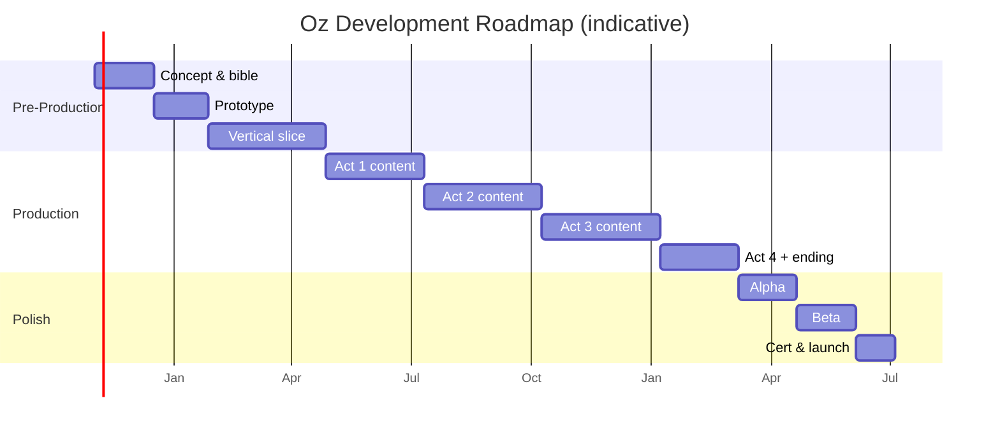

# Game Plan — Roadmap

> Working title: **Oz: The Road Home**. Target: mid-scope stylized action-adventure, 8–12 h campaign.

## Phase Overview

## Phase Detail

| Phase | Duration | Exit criteria |
| --- | --- | --- |
| **Concept & bible** | 6 weeks | This vault complete; greenlight |
| **Prototype** | 6 weeks | Feel tests pass ([[Prototype Plan]]) |
| **Vertical slice** | 12 weeks | Act 1 playable end-to-end w/ boss |
| **Production** | ~10 months | All 4 acts content complete |
| **Alpha** | 6 weeks | Feature complete, all bosses in |
| **Beta** | 6 weeks | Content lock, bug fixing |
| **Cert & launch** | 4 weeks | Platform requirements met |

## Content Budget

| Item | Target |
| --- | --- |
| Regions | 4 (+ Emerald City hub) |
| Bosses | 5 (incl. cold open) |
| Companions | 3 |
| Enemy families | 6–8 |
| Main quests | 8–10 |
| Side quests | 6–8 |
| Playtime | 8–12 h |
| VO lines | ~2,000 |
| Music cues | ~25 |

## Team Shape (minimum viable)

| Role | Count |
| --- | --- |
| Design (systems/level) | 1–2 |
| Engineering | 2 |
| 3D Art/Animation | 2 |
| 2D/UI | 1 |
| Audio | 1 (contract) |
| Writing | 1 (part-time) |
| Production | 1 |

## Milestones

See [[Milestones & Backlog]].

## Risks

See [[Risk Register]].

## Related

- [[Vision & Pillars]]
- [[Scope, Audience & Platform]]
- [[Prototype Plan]]
