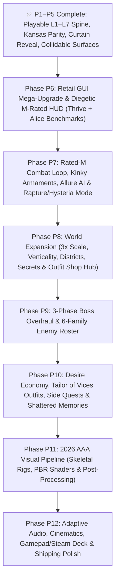

# *Oz: The Road Home* — Retail Completeness Audit & Phase P6–P12 Master Roadmap

> **Honest Human-Player Verdict (2026-11-23):**
> After Phases P1–P5, *Oz: The Road Home* is a **clean, bug-free, playable 7-level vertical-slice spine (~12–15 minutes end-to-end)** — roughly **15–18% of a complete, buyable 8–12 hour retail game**.
> It now proves the story beats, party switching, 3D world-building, interiors, and dialogue flow, **but it still plays like a diorama draft** rather than a \$40–\$60 retail dark-fairytale action-adventure someone would buy at Steam, GameStop, or Walmart.

---

## 1. Full-Sweep Human-Player Audit (Where We Are vs. Retail Bar)

| Pillar | Current State (Post-P5) | Gap to Retail-Grade Game | Target Rating |
| --- | --- | --- | --- |
| **1. World Scale & Exploration** | Small flat rectangular arenas (`~80–120m`); linear sprint from trigger to trigger; ~2 min per level. | Needs **3×–4× larger multi-zone levels**, vertical cliffs/stairs/bridges, destructibles, secret alcoves, Velvet Sanctums, and environmental puzzles. | **15% → 100%** |
| **2. Combat & Rated-M Identity** | Single `F` button attack per character; basic chase AI; **zero** M-rated mechanics implemented yet (despite rich `[[Kinky Armaments]]` & `[[Outfit Shop]]` vault docs). | Needs lock-on camera, 3-hit combos, **Lace Whip / Silk Bindings / Hypnotic Perfume / Gilded Chain**, **Enamored & Intimidated AI states**, **Rapture/Hysteria mode**, hit-stop, and visceral impact VFX. | **12% → 100%** |
| **3. Bosses & Enemy Depth** | 1–2 enemy silhouettes; Marshal & Witch encounters end in seconds with minimal telegraphing. | Needs **6 enemy families + 2 elites** and **4 true multi-phase bosses** with floor AoE telegraphs, stagger meters, environmental kills, and companion finishers. | **15% → 100%** |
| **4. GUI & Shell Polish** | Clean dark-gold HUD, Pause & Settings menus; still reads as an indie prototype rather than a AAA/AA retail shell. | Needs *Thrive*-grade modular UI + *Alice*-grade diegetic **Silver-Rose Health**, **Desire/Allure wheel**, **Oz Grimoire/Codex**, **Save/Load slots**, **3D Main Menu**, and **Tailor of Vices Shop UI**. | **35% → 100%** |
| **5. Visual Fidelity & Animation** | Procedural primitives upgraded to sculpted multi-part geometry; still lacks skeletal rigging, PBR textures, and post-processing. | Needs glTF/Blender rigged characters & blend-tree animations, painted/procedural PBR normal+roughness maps, SSAO/Glow/Volumetric Fog, and dramatic "Beautiful Corruption" shaders. | **25% → 100%** |
| **6. Narrative, Side Quests & Progression** | Main quest spine works; Whimsy pickups are simple collectibles; no side quests, no economy, no upgrades. | Needs **Desire Fragments economy**, **Tailor of Vices Outfit Shop** (4 collections with gameplay perks), **6–8 side quests ("Vile Requests")**, and **Shattered Memories**. | **20% → 100%** |
| **7. Audio & Game Feel** | Minimal/silent prototype audio; basic camera movement. | Needs adaptive multi-layer soundtrack, spatial combat/world SFX, character barks, cinematic camera framing, controller/Steam Deck glyphs, and full accessibility suite. | **10% → 100%** |

---

## 2. Master Phase Mind-Map (Self-Recursive Execution Graph)

Each phase below is self-contained, testable via headless Godot 4.8 sims, and designed so the founder can simply prompt **"Proceed with Phase P6"**, **"Proceed with Phase P7"**, etc.

---

## 3. Detailed Phase Blueprints (P6 → P12)

### Phase P6 — Retail-Grade GUI Mega-Upgrade & Diegetic M-Rated HUD
* **References:** `[[Reference Benchmarks - Thrive & Alice Madness Returns]]`, `[[GUI & UX Roadmap]]`
* **Deliverables:**
  1. **3D Live-Diorama Main Menu** (`Title / Continue / Load Game / Chapter Select / Settings / Quit`) with animated Yellow Brick Road & Emerald spires in the background.
  2. **Diegetic *Alice*-Class HUD**:
     - Organic **Silver-Rose Vitality Meter** (petals wither/scatter on damage, glow silver-crimson on heal).
     - **Desire / Allure Filigree Arc** + companion resource meters (**Brain / Heart / Courage**).
     - Auto-fade exploration restraint (HUD dims cleanly out of combat, snaps crisp on threat).
     - **Radial / Quick-Wheel Selector** (`Q` or `Right-Click` hold) for swapping Lead Companion + Active Armament.
  3. **Oz Grimoire / Codex Overlay (`Tab` / `J`)**: Tabs for *Quests*, *Companions & Kits*, *Armaments*, *Bestiary*, *Shattered Memories*, and *Region Map*.
  4. **Save/Load Slot Manager**: 3 persistent JSON save slots (`user://saves/slot_*.json`) storing level, Desire Fragments, unlocked outfits, memories, and quest state.
  5. **Centralized `oz_retail_theme.tres`** with gilded bevels, velvet-glass panels, and crisp typography across 16:9 & 16:10 viewports.

---

### Phase P7 — Rated-M Combat Overhaul, "Kinky Armaments" & Hysteria Mode
* **References:** `[[Vision & Pillars]]`, `[[Kinky Armaments]]`, `[[Movement, Red Shoes & Kick]]`
* **Deliverables:**
  1. **Lock-On Camera (`Middle-Click` / `R`)** with ornate clockwork-rose reticle & directional off-screen threat arcs.
  2. **3-Hit Melee Combo + Aerial Kick + Hit-Stop & Screen Shake** for Dorothy, Scarecrow, Tin Man, and Lion.
  3. **Tools of Allure (`1–4` Armament Slots / Wheel)**:
     - **The Lace Whip**: Mid-range lash that binds & yanks enemies straight into Dorothy's Silver-Shoe Kick.
     - **Silk Bindings**: Ranged cocoon projectile immobilizing enemies & multiplying Allure damage.
     - **Velvet Blindfold**: Blinds target, extending **Enamored** duration.
     - **Gilded Chain**: Tethers two enemies so damage dealt to one mirrors onto the other.
     - **Hypnotic Perfume (Active Aura)**: Enemies caught in the mist enter **Enamored** (stop attacking Dorothy, turn on other foes, stunned by Silver-Shoe Blink).
  4. **Rapture / Hysteria Desperation Mode (`H` when meter full or critical HP)**: Full-screen Kansas-monochrome + neon-crimson post-process shader, temporary invulnerability, 2.5× damage, and cinematic finisher VFX.
  5. **Desire Fragments Currency**: Dropped dynamically from bound/enamored executions with magnet-pickup particles.

---

### Phase P8 — World Expansion & Level Scale (3×–4× Playable Footprint)
* **References:** `[[Scope, Audience & Platform]]`, `[[Art & Audio Direction]]`
* **Deliverables:**
  1. **L2 Munchkinland Expanded**: Split into 4 interconnected districts (*Crash Square*, *Lollipop Guild Market*, *Whispering Cornfield Maze*, *Rusted Timber Ravine*) with terraced hills, stone bridges, 6+ enterable cottages, and hidden **Erotic Shrines / Velvet Sanctums**.
  2. **L3 Poppy Road Expanded**: Multi-stage vertical canyon with billowing narcotic mist pockets, wind-draft jump pads, and optional cliffside shortcuts.
  3. **L4 Winkie Castle Expanded**: Multi-tier dark-iron courtyard + battlement walkways + Winged Monkey aerial ambush perches + inner Cistern Sanctum.
  4. **L5 Emerald City Expanded**: Grand boulevard leading to the Palace with **The Tailor of Vices** boutique, decadent neon-emerald market stalls, and multi-courtyard Palace approach.
  5. **Environmental Puzzles**: Companion-gated barriers (Tin Man rusted chains, Scarecrow flock switches, Lion intimidation gates, Dorothy Silver-Shoe blink gaps).

---

### Phase P9 — Multi-Phase Boss Overhaul & 6-Family Enemy Roster
* **References:** `[[06 Bosses]]`, `[[05 Enemies]]`
* **Deliverables:**
  1. **6 Distinct Enemy Families + 2 Elites**: Rogue Munchkin Axemen, Porcelain Dolls (crack to reveal gears), Poppy Wraiths, Winkie Iron Guards (armored), Winged Monkey Dive-Bombers, and Emerald Clockwork Sentinels.
  2. **4 True Multi-Phase Bosses** with dedicated Boss Health/Stagger HUD bar, ground AoE telegraph rings, and phase transitions:
     - **Lollipop Guild Marshal** (Munchkinland): Phase 1 Axe Cleave → Phase 2 Enraged Spin & Minion Rally.
     - **The Kalidah Chimera** (Wilds/Poppy): Phase 1 Pounce & Roar → Phase 2 Shadow Stalk & Companion Synergy Break.
     - **Wicked Witch of the West** (Winkie Castle): Phase 1 Umbrella-Staff Hexes → Phase 2 Winged Monkey Swarm & Fire Rings → Phase 3 Water Cistern Vulnerability & Melt Finale.
     - **The Wizard's Clockwork Spectacle** (Emerald Palace): Phase 1 Hologram Laser/Shockwave → Phase 2 Brass Automaton Guard → Phase 3 Curtain Pull & Oscar Diggs Reveal.

---

### Phase P10 — Tailor of Vices Outfit Shop, Side Quests & Shattered Memories
* **References:** `[[Outfit Shop]]`, `[[Core Loop]]`, `[[Progression & Upgrades]]`
* **Deliverables:**
  1. **Interactive Outfit Shop ("The Tailor of Vices")** accessible in Munchkinland & Emerald City with live 3D rotating character preview.
  2. **4 Unlockable Collections** with real gameplay perks (Allure Multiplier, Intimidation Aura, Blink Cooldown, Fragment Drop Bonus):
     - *The Gingham Collection* (Dorothy: Prairie Innocent → Velvet Corset → Silver-Lace Sovereign)
     - *The Burlap & Leather Collection* (Scarecrow)
     - *The Chrome & Velvet Collection* (Tin Man)
     - *The Primal Gold Collection* (Lion)
  3. **6–8 Side Quests ("Vile Requests")** + **12 Shattered Memories** (unlocking lore in the Oz Grimoire) + **4 Velvet Sanctum Challenge Arenas** (timed combat/stealth trials).

---

### Phase P11 — 2026 AAA Visual Pipeline (Skeletal Rigs, PBR Shaders & Lighting)
* **Deliverables:**
  1. Replace primitive-built hero/boss rigs with **skeletal `Skeleton3D` + `AnimationTree` blend states** (idle, walk, sprint, jump, combo 1-2-3, whip lash, blink, hit-react, death).
  2. **PBR Surface Overhaul**: Custom triplanar / normal + roughness + metallic shaders for Yellow Brick cobbles, weathered Kansas timber, cracked porcelain, gilded emerald crystal, and wet reflecting marble.
  3. **Forward+ Post-Processing**: Subtle SSAO, ACES Filmic Tonemapping, Volumetric Fog per biome, selective Glow/Bloom, and *Alice*-style **Beautiful Corruption** contrast shaders.
  4. **Destructible Props**: Breakable crates, porcelain urns, and crystal lanterns spilling Desire Fragments.

---

### Phase P12 — Adaptive Audio, Cinematics, Controller & Shipping Polish
* **Deliverables:**
  1. **Adaptive Multi-Layer Audio Bus**: Exploration ↔ Combat ↔ Boss ↔ Hysteria crossfading stems + spatial 3D SFX (silver-shoe chime, whip crack, axe clang, crow caw, lion roar, tornado howl, curtain draw).
  2. **Choreographed Story Cameras**: Smooth camera framing for Tornado Takeoff, Locasta's Blessing, Witch Melt, Oz Curtain Reveal, and Glinda's Silver-Shoe Finale.
  3. **Full Accessibility & Controller Suite** (`[[Accessibility & Difficulty]]`): Dynamic Keyboard / Xbox / PlayStation / Steam Deck button glyphs, remappable controls, Difficulty presets (*Story / Standard / Nightmare*), and frame-pacing optimization to locked 60 FPS.

---

## Related
- [[Reference Benchmarks - Thrive & Alice Madness Returns]]
- [[Oz Control Room]]
- [[Prototype Progress Log]]
- [[Vision & Pillars]]
- [[Kinky Armaments]]
- [[Outfit Shop]]
