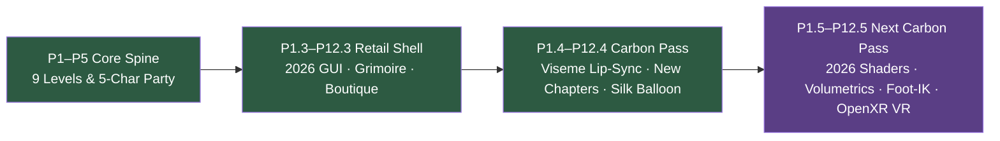

# 📖 OZ: THE ROAD HOME — DESIGN VAULT
### *Living Game Design Bible, Art Direction, Prompt Libraries & Multi-Phase Production Roadmap*

[-C8A252?style=for-the-badge)](#canonical-rules--pillars)

*The single source of truth for **Oz: The Road Home** — designed for both human creators in Obsidian and autonomous AI engineering agents building the Godot 4.8 game.*

---

## 🌟 About This Vault

`obsidian-oz` is the structured **Obsidian.md Design Bible and Production Control Room** for **[Oz: The Road Home](https://github.com/realdyl/oz)**, a stylized third-person 3D dark-fairytale action-adventure RPG adapting all **24 chapters** of L. Frank Baum's 1900 public-domain novel *The Wonderful Wizard of Oz*.

Start exploring in Obsidian at **[[Oz Control Room]]**.

---

## 🗂️ Vault Directory Map

| Folder | Purpose & Key Documents |
| --- | --- |
| `01 Vision/` | Core pitch, aesthetic pillars (*Alice: Madness Returns* × Baum 1900), scope, and public-domain IP guardrails (`Vision & Pillars.md`). |
| `02 World/` | Complete 9-level geography, regional palettes, and Yellow Brick Road spine (`Kansas`, `Munchkinland`, `Kalidah Wilds`, `Poppy Field`, `Winkie Keep`, `Emerald City`, `China Country`, `Quadling Court`, `Homecoming`). |
| `03 Characters/` | Character bibles for Dorothy Gale (18), Toto, Scarecrow, Tin Woodman, Cowardly Lion, Locasta, Glinda, Wicked Witch of the West, China Princess, and Oscar Diggs. |
| `04 Systems/` | Core loop, 5-character Lead swapping, Silver Shoes mobility, `F` combat verbs vs. `Z`/`X`/`C` extra superpowers, Boutique Couture, Style Rank, and accessibility/gamepad design. |
| `05 Enemies/` | Enemy roster (Rogue Munchkins, Lollipop Guild Marshals, Fighting Trees, Winged Monkeys, Kalidah Shadow-Beasts) and counter-play recipes. |
| `06 Bosses/` | Multi-phase boss frameworks (Wicked Witch of the West cistern melt, Oz Hologram curtain reveal, Giant Forest Spider). |
| `07 Quests/` | 24-chapter Main Questline, Vile Requests (side quests), Velvet Sanctums, and Shattered Memories lore. |
| `08 Technical/` | Godot 4.8 Forward+ architecture, [[GUI & UX Roadmap]], [[Typography & Signpost Style Guide]], [[Agent Token Efficiency]], and [[Auto Git Policy]]. |
| `09 Production/` | [[Prototype Progress Log]], [[Book-Length Runtime & Pacing Blueprint]] (`3.5–4.5 hr` target), [[Gemini 4 Carbon - P1.4 to P12.4 Master Plan]] *(Completed)*, and **[[Gemini 4 Carbon - P1.5 to P12.5 Master Plan]]** *(2022 → 2026 visual/shader leap + OpenXR VR)*. |
| `10 Prompt Libraries/` | Nano Banana Pro image-generation prompt libraries for loading screens, character portraits, couture boutique icons, companion ability medallions, and bestiary cards. |
| `99 Meta/` | Standardized note templates and YAML frontmatter conventions. |

---

## 🧭 Recommended Reading Order

1. **[[Oz Control Room]]** — Live project dashboard, active decisions, and links to every pillar.
2. **[[Vision & Pillars]]** — Tone, dark-fairytale visual direction, and Baum 1900 public-domain rules.
3. **[[Book-Length Runtime & Pacing Blueprint]]** — 24-chapter-to-9-level pacing budget (`~3.5–4.5 hours` total, `15+ min` per level).
4. **[[Prototype Progress Log]]** — Dated engineering changelog synced 1:1 with `realdyl/oz` commits.
5. **[[Gemini 4 Carbon - P1.5 to P12.5 Master Plan]]** — Next major milestone blueprint (custom 2026 PBR/SSS shaders, Volumetric Fog/SSAO/SSIL, lofted seamless character geometry, dynamic PS5/Xbox/Switch glyphs, and optional Meta Quest 3 / Apple Vision Pro OpenXR VR).

---

## 📈 Production Roadmap & Phase Status

| Milestone | Status | Highlights |
| --- | --- | --- |
| **P1–P5 Core Spine** | ✅ Shipped | All 7 core acts, 5 playable characters, 3D interiors, and headless QA harnesses. |
| **P1.3–P12.3 Retail GUI & Systems** | ✅ Shipped | Gothic-filigree Title Screen, Open-Book Grimoire, 3D Turntable Boutique, Style Rank, Vile Requests, NG+, floor-clamped 360° camera. |
| **P1.4–P12.4 Carbon Expansion** | ✅ Shipped | Real-time viseme lip-sync + ElevenLabs hook, zero-occlusion Spyro dialogue camera, deduplicated `F` vs. `C` kits, 9 Nano Banana Pro icons, PS5/Xbox/Switch gamepad bindings, 16-gore Victorian Silk Balloon, 2026 smoked-glass plaques, and **2 new Baum chapters (`L3a Kalidah Wilds`, `L6a Dainty China Country`)**. |
| **P1.5–P12.5 True 2026 Fidelity** | 🗓️ Planned | Skin SSS / Velvet Fresnel / Triplanar PBR shaders, Forward+ Volumetric Fog + SSAO + SSIL, seamless lofted character meshes & Foot-IK, 15+ min depth across all 9 acts, optional OpenXR VR Diorama mode. |

---

## 🤖 Protocol for AI Agents

Before modifying code in [`realdyl/oz`](https://github.com/realdyl/oz) or notes in `obsidian-oz`:

1. **Read First:** [[Agent Token Efficiency]], [[Prototype Progress Log]], and the active Master Plan (`09 Production/Gemini 4 Carbon - P1.5 to P12.5 Master Plan.md`).
2. **Enforce Canon:** Strictly follow L. Frank Baum's **1900 public-domain text** (Silver Shoes, chalk-pale one-eyed Wicked Witch of the West, Locasta, Glinda, Omaha balloon). Never introduce MGM 1939 copyrighted elements.
3. **Prove With Headless QA:** Every gameplay change must exit `0` across all 5 suites (`smoke_check.gd`, `kansas_sim.gd`, `play_sim.gd`, `act34_sim.gd`, `retail_p3_sim.gd`) with zero `SCRIPT ERROR`s.
4. **Follow [[Auto Git Policy]]:** Append a dated summary to [[Prototype Progress Log]], then commit and push both `realdyl/oz` and `realdyl/obsidian-oz` together.
5. **Vault Conventions:** Include YAML frontmatter on content notes, use `[[Wikilinks]]`, and use Mermaid for architecture/flow diagrams (see [[Design Note Template]]).
